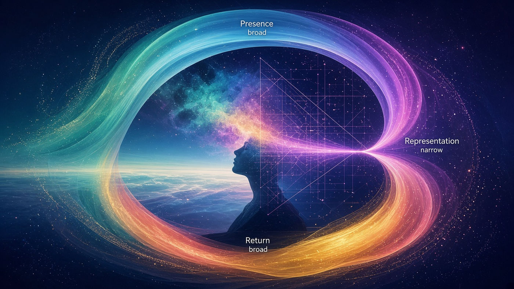

{fig-alt="A silhouette inside a glowing loop. Presence and broad attention are at the top, Representation and narrow attention at the right point where a geometric grid converges, and Return and broad attention at the bottom."}

# The New Junior: Yesterday's Senior, Plus AI

::: {.summary}
📘 **What the title means**

- **Yesterday's senior (2017)** was the one who could own a feature end to end: frontend, backend, data, testing and deployment, thinking first and typing second (**Presence**, **Representation**, **Return**).
- **The new junior (2027) starts there.** That is the baseline: where you start, not where you arrive.
- **Plus AI**: AI agents, agentic programming, ML and LLMs (cloud and local) now write much of the code.
- **So the new junior does senior work**: direct the agents, orchestrate them and review what they produce. That used to be the senior's job.
- **The new senior layer is AI engineering**: agents, orchestration, models, evaluation and their cost and risk.
- **Everything changes**: the tools, the team and the job. The way of thinking stays, and it matters more.
:::

> **Be a fullstack AI engineering junior, be the 2017 senior in 2027.**

---

## 1. What changed

### The 2025 skill set is the floor

The list of languages, frameworks, version control, DevOps and AI tools is on [About a developer (2025)](/about/about-this-developer.qmd). It still applies, and this page does not repeat it.

### Yesterday's senior, today's junior

This page adds one skill on top of it:

- **Fullstack AI engineering junior**: you can build every layer, from the database and the REST API to the React screen and the deploy, and you can put AI to work in it.
- **The 2017 senior in 2027**: you decide where your attention goes, you move between the whole and one piece on purpose, and you use AI inside that loop, not in place of it. The tools change. The way of thinking does not.

## 2. How a senior thinks

### The senior programmer cycle

::: {.column-margin}
[{style="max-height: 16rem; width: auto; max-width: 100%;"}](../images/ifcd0021-26/docs/senior-programmer-cycle.html){.external target='_blank'}
:::

From the [senior programmer cycle](../images/ifcd0021-26/docs/senior-programmer-cycle.html){.external target='_blank'}:

> A senior does not start by typing. They see the whole feature, make one piece clear, build it, then look at the whole again. Typing code is the result of that thinking. The tools change. The way of thinking does not.

### One iteration, three moves

If you know [Scrum](/scrum/scrum-what-concepts.qmd), you already know the iteration: a short cycle that ends with something you can inspect, and the next one adapts. The senior applies the same idea to every feature, in three moves:

| Move | Attention | What you do | Typical failure |
|---|---|---|---|
| **Presence** | Broad, no typing | Say the feature in your own words, set the goal, sketch a mockup and skeleton, find the unknowns | You start naming things you don't understand, or you stay broad and never name anything |
| **Representation** | Narrow, then type | Names, flow, data model, tree or UML, small steps (riskiest slice first), type only that slice and verify it | You keep naming and building past the point where the piece is clear |
| **Return** | Broad again | Run the real thing, compare it with the first sketch, list new unknowns, update the picture | You polish the part and never check the whole |

- The iteration ends by looking at the whole again, and the **next iteration starts from there**.
- **Names** run through all three moves. A confusing name usually points to a confusing design.
- The broad/narrow distinction is borrowed from McGilchrist, as the cycle page explains.

### Any goal, same iteration

A sprint can deliver a screen, an API or a model. The cycle page applies the same three moves to each of them:

- a **React screen**: tap *Add to cart* and the number in the header goes up
- a **REST endpoint**: `POST /orders` returns the order and its total
- a **CRUD database service**: create, read, update and delete a customer
- a **classifier**: will this customer renew next month, yes or no?

The language and the framework change. The three moves stay, iteration after iteration.

## 3. Working with AI

### You direct the attention

An AI agent can type the slice for you. It does not hold the whole for you. In each iteration:

- **Presence is yours.** The one-sentence feature, the goal, the sketch and the unknowns are the brief the agent works from.
- **Representation is shared.** You choose the names, the data model and the slice; the agent can type that slice.
- **Return is yours again.** Run it, compare it with the sketch, not with the code, and ask what the agent assumed.

The [Full-Stack AI Engineering Map](https://diagrammersamples.s3.eu-central-1.amazonaws.com/Full-Stack-AI-Engineering-Map.html){.external target='_blank'} works the same way: its first lab is a ticket system *built fast with agents from a fixed spec and tests*, followed by an audit: *what did the agent assume?*

### Agents and agentic programming

A chat assistant answers a question. An **agent** works on a task in a loop, with tools:

- **Plan**: it breaks the task into steps.
- **Use tools**: it reads files, searches the code, runs commands in a terminal, calls APIs.
- **Edit**: it changes code across several files.
- **Run and check**: it runs the build, the linter and the tests, reads the errors and tries again.

**Agentic programming** is working this way on purpose. The developer's job moves to three verbs:

- **Brief**: the feature in one sentence, the goal, the files that matter, what "done" looks like. This is Presence written down.
- **Constrain**: the slice, the tests it must pass, what it must not touch (dependencies, versions, secrets, other modules).
- **Review**: read the diff, run the real thing, compare it with the sketch. This is Return, and it is never skipped.

::: {.callout-tip title="Tests are the contract"}
An agent with fixed tests has a clear target. An agent without tests has only your words. Write or pick the tests before you hand over the slice.
:::

### Orchestration: several agents, one picture

Bigger work can be split across several agents or subagents. You become the **orchestrator**:

- **Split the work** along the seams you found in Representation: one agent per slice, module or question (research, backend, frontend, tests, docs).
- **Hand off with a written brief**: goal, inputs, constraints and the expected output. An agent does not share your memory, so the brief must stand alone.
- **Keep the whole in one place**: one person, or one coordinating agent, holds the picture and merges the results.
- **Human in the loop**: you approve the steps that are hard to undo, such as merging, deploying, deleting data or sending anything outside.
- **Guardrails**: limited permissions, separate branches or worktrees per agent, no secrets in prompts, CI that must pass.
- **Review diffs and PRs** as you would a colleague's: small commits, clear messages, one change per PR.

Orchestration is the same iteration at team scale: broad when you split the work, narrow inside each agent, broad again when you merge and check the whole.

### Local LLMs

You can run an open-weight model on your own machine instead of calling a cloud API.

**Why**

- **Privacy**: code and data stay on your machine.
- **Cost**: no bill per request once the hardware is there.
- **Offline**: it works without a connection.
- **Learning**: you see how models, context windows, quantization and prompts really behave.

**What it takes**

- **A runner**:
  - [Ollama](https://ollama.com){.external target='_blank'}: download and run models from the command line, with a local API.
  - [LM Studio](https://lmstudio.ai){.external target='_blank'}: a desktop app to find, run and chat with local models, with a local server.
  - [llama.cpp](https://github.com/ggml-org/llama.cpp){.external target='_blank'}: the C/C++ inference engine many local tools build on.
- **An open-weight model**: published model files you can download, for example from [Hugging Face](https://huggingface.co/models){.external target='_blank'}. Check each model's licence.
- **Hardware**: memory is the main limit. Bigger models need more RAM or GPU memory; a GPU or Apple silicon makes them faster.
- **Quantization**: storing the weights with fewer bits makes a model smaller and faster, at some cost in quality.

**Tradeoffs against cloud models**

| | Local model | Cloud model |
|---|---|---|
| Data | Stays on your machine | Sent to a provider |
| Cost | Hardware and electricity | Pay per use or subscription |
| Quality | Usually smaller models | Usually the largest, newest models |
| Speed | Depends on your hardware | Depends on the network and the provider |
| Setup | You install, update and choose | Ready to use |

A good habit from the map applies here too: show that the bigger tool beats the simpler one on your own tests before you pay for it.

## 4. Worked example: a shopping cart in five iterations

One example of the iteration in code: the branch [cursor/skeleton-senior-cycle-bf99](https://github.com/AlbertProfe/cartShoppingContext/tree/cursor/skeleton-senior-cycle-bf99){.external target='_blank'} of **cartShoppingContext** (React with Vite). Each iteration is one commit with its own Presence, Representation and Return.

| # | Commit | Presence → Representation → Return |
|---|---|---|
| 1 | [`0bdc952`](https://github.com/AlbertProfe/cartShoppingContext/commit/0bdc952709dde1835ae60a4ddcca0e0ef8e3373c){.external target='_blank'} hard-coded screen | Data draft first → name every component → the screen matches the sketch, clicks do nothing |
| 2 | [`599c141`](https://github.com/AlbertProfe/cartShoppingContext/commit/599c1417ca43ab347ffd4976265885d8f73fd97f){.external target='_blank'} data down via props | A line keeps `productId` → one `products` array → a price edit shows on shelf and line, totals don't follow |
| 3 | [`d449e30`](https://github.com/AlbertProfe/cartShoppingContext/commit/d449e30843d2e96a5104e3cf8e2f90b7cf8da64b){.external target='_blank'} state and handlers | Rules before code → `useState` and handlers → figures checked by hand, props walk too far |
| 4 | [`de0bdca`](https://github.com/AlbertProfe/cartShoppingContext/commit/de0bdcaf4704786bf78d2d0d944bb9e9bdaa5a6a){.external target='_blank'} context, reducer, folders | The path is the problem → `CartProvider`, `useReducer`, folders → same clicks, same figures |
| 5 | [`d0cf1cb`](https://github.com/AlbertProfe/cartShoppingContext/commit/d0cf1cbe2022f9faa6adcb7017601d45fc7becdc){.external target='_blank'} tests, localStorage, refactor | Will it work tomorrow? → Vitest, `localStorage`, name pass → tests pass, a reload keeps the cart |

## 5. A curriculum example: the Full-Stack AI Engineering Map

The [Full-Stack AI Engineering Map](https://diagrammersamples.s3.eu-central-1.amazonaws.com/Full-Stack-AI-Engineering-Map.html){.external target='_blank'} is one example of a draft curriculum for the fullstack AI engineering junior: taught blocks from Git, Linux and SQL through Spring Boot, React, DevOps and cloud, to machine learning and GenAI, plus project labs.

### Every lab is an iteration

Its labs repeat the same iteration:

- **Brief** and **Audit** (*keep, swap, drop or add*) are Presence.
- **Change**, *with an AI agent, against fixed tests*, is Representation.
- **Break** (a failure drill) and **Record** are Return.

## 6. Senior reality: beyond "it works"

The cycle page adds what each iteration meets in real work:

- **Other people**: say which move you are in during review; in pairing, one holds broad attention and one narrow.
- **Maintenance**: read, run and reproduce before fixing; name the cause before you fix it.
- **Non-functional before "done"**: load, permissions, observability, data migration and rollback, checked at the end of Return.
- **Tooling**: small commits, tests (*Return written down*), CI, feature flags, deploy and rollback.

## 7. Checklist for the new junior

- [ ] I can say the feature in one sentence before I open the agent.
- [ ] I write the brief: goal, files, constraints, definition of done.
- [ ] I give the agent tests, or write them first.
- [ ] I read every diff and run the app before I accept it.
- [ ] I can split a task across agents and merge the results.
- [ ] I keep secrets out of prompts and approve the steps that are hard to undo.
- [ ] I have run at least one local model with Ollama, LM Studio or llama.cpp.
- [ ] I can explain when I would choose a local model and when a cloud model.

## 8. Three questions to keep

When narrow attention takes over, ask:

- Can you say in one sentence what should happen when someone clicks? If not, go back to **Presence**.
- Does the running page behave like the first sketch? Check again at **Return**.
- Which parts really need this tool? Rethink at **Representation**.

## References

- [About a developer (2025)](/about/about-this-developer.qmd)
- [How a senior programmer thinks: the senior programmer cycle](../images/ifcd0021-26/docs/senior-programmer-cycle.html){.external target='_blank'}
- [cartShoppingContext, branch cursor/skeleton-senior-cycle-bf99](https://github.com/AlbertProfe/cartShoppingContext/tree/cursor/skeleton-senior-cycle-bf99){.external target='_blank'}
- [Full-Stack AI Engineering Map](https://diagrammersamples.s3.eu-central-1.amazonaws.com/Full-Stack-AI-Engineering-Map.html){.external target='_blank'}
