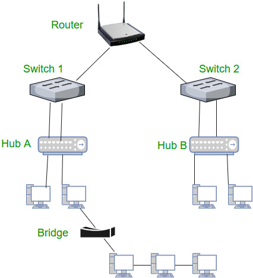
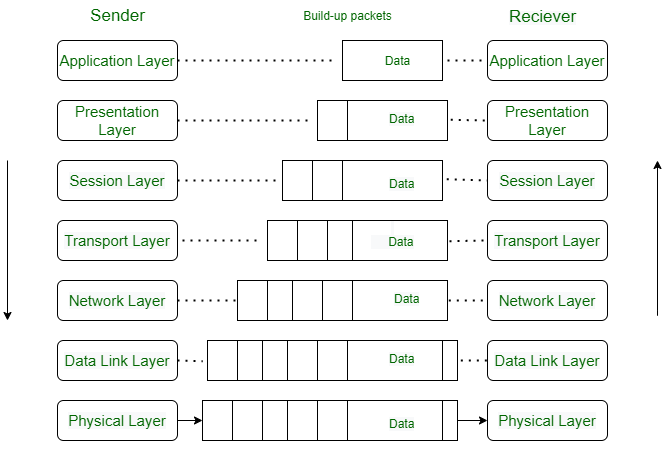
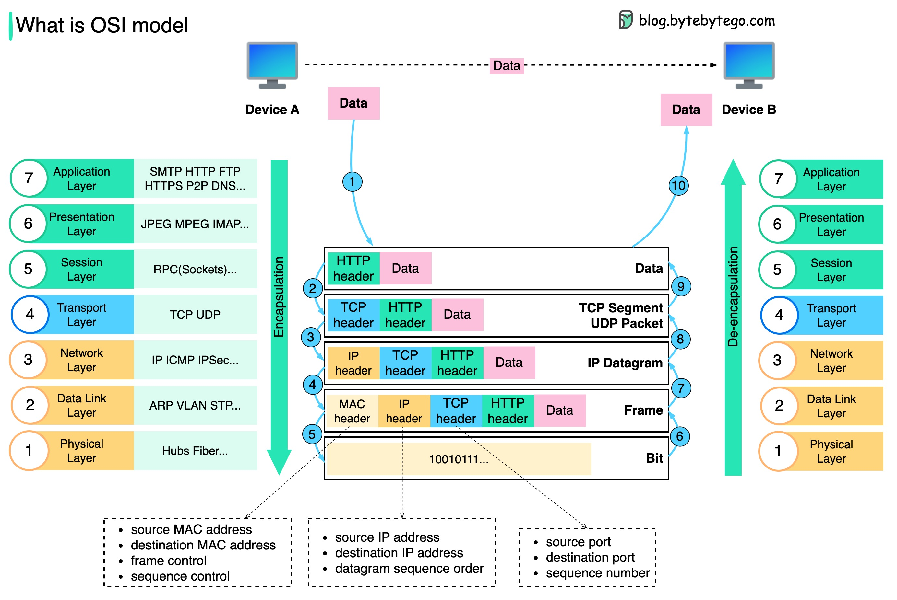

# What is a Network?

A network is two or more independent devices or computers linked so they can share resources (such as printers and CDs), exchange files, or communicate electronically.

For example, the computers on a network may be linked through telephone lines, cables, satellites, radio waves, or infrared light beams.

Two very common types of network are:

- Local Area Network (LAN)
- Wide Area Network (WAN)

In the OSI reference model, layer 3 — the network layer — forwards packets and routes them through intermediate routers. When a packet is for the local host, this layer passes it up to the transport layer (layer 4).

Computers and peripherals are connected through equipment such as routers and switches. If two devices are connected on the same link, they can exchange frames without a router.

::: {.callout-note title="Summary"}
A network links devices so they can share resources and communicate. A LAN covers a small area, such as a home or an office. A WAN spans a much wider area. The network layer routes packets between networks. On a single link, a router is not required.
:::

# Internetworking devices used on a network

Connecting a network, and connecting that network to the Internet, takes several kinds of device. Some of the common ones are below.

- **NIC**: A network interface card (NIC) is a printed circuit board installed in a workstation. It is the physical connection between the workstation and the network cable. Although a NIC operates at the physical layer of the OSI model, it is also considered a data-link layer device. Part of the NIC's job is to pass information between the workstation and the network. It also controls the transmission of data onto the wire.

- **Hubs**: A hub extends the reach of a cabling system by amplifying the signal and then retransmitting it. Hubs are basically multiport repeaters and are not concerned with the data at all. A hub connects workstations and sends every transmission to all of the connected workstations.

- **Bridges**: As networks grow, they often become difficult to manage. A growing network is often divided into smaller LANs, and those LANs are connected through bridges. This cuts down the traffic on each segment. A bridge also watches frames as they move between segments and keeps track of the MAC address associated with each port.

- **Switches**: Switches are used instead of bridges. They are the usual way to connect a network now, because they are faster and more intelligent than bridges. A switch can send a frame to a specific workstation, so each workstation can transmit independently of the others. It is like a modern phone system, in which several private conversations take place at once.

- **Routers**: A router directs data along the most efficient and economical route to the destination. Routers operate at network layer 3, so they forward by IP address rather than by physical (MAC) address. They connect two or more networks. They can also link different network types, such as Ethernet, FDDI, and Token Ring.

- **Brouters**: A brouter combines a router and a bridge. It acts as a filter: it lets some data onto the local network and redirects unknown data to the other network.

- **Modems**: A modem converts a computer's digital signals into analog signals that travel over phone lines.

::: {.callout-note title="Summary"}
These devices do different jobs. A hub repeats a signal to every port. A bridge or a switch forwards frames by MAC address. A router forwards packets by IP address and joins separate networks. A modem converts between digital signals and the analog signals on a phone line.
:::

# Understanding TCP/IP layers

{.column-margin fig-alt="Schematic of encapsulation. The sender's seven OSI layers are on the left and the receiver's are on the right. In the center, a block of data gains another header cell at each lower layer, from the application layer down to the physical layer. Arrows show the sender building the message downward and the receiver reading it upward."}

TCP/IP stands for Transmission Control Protocol/Internet Protocol. It describes how a computer connects to other computers and how data is transmitted between them.

- **TCP** breaks data into segments before they are sent, and reassembles those segments when they arrive.
- **IP** (Internet Protocol) addresses each packet and routes it from the source host to the destination host.

::: {.callout-note title="Summary"}
TCP/IP is the stack used on the Internet. IP addresses a packet and routes it. TCP adds reliable, ordered delivery on top of IP. The layers below carry that packet as a frame and then as bits on a cable, fiber, or radio link.
:::

## How is data sent?

How does data actually cross the network, and why does the model use so many layers?

<mark>Each layer has one job. It adds a header, or removes one, and it treats everything inside as payload it does not need to interpret.</mark>

The figure below follows one message from device A to device B. On the way out the message is encapsulated: each layer wraps the layer above. On the way in it is de-encapsulated: each layer unwraps its own header. The running example is **HTTP/1.1 over TCP**, the usual web request. HTTP/1.1 and HTTP/2 travel over TCP. HTTP/3 uses QUIC, and QUIC runs over UDP.

{fig-alt="ByteByteGo diagram titled What is OSI model, with a blog.bytebytego.com watermark. Device A sends data to device B. Going down the stack, the message gains an HTTP header, then a TCP header, then an IP header, then a MAC header, and is sent as binary bits. Going up, device B removes those headers until the application can read the data. Three notes list MAC addresses and frame control, IP addresses, and the source port, destination port, and sequence number."}

The numbered circles in the figure are the steps below. On a narrow screen, scroll the figure sideways to read the labels, or select it to open a larger copy. The stack drawn on the left lists all seven OSI layers. This example only adds a header where the Internet suite has one, so the presentation and session layers appear in the key and do not grow a header of their own.

**Step 1.** Device A has data for device B. At the application layer, HTTP adds an HTTP header: the request or the status line, plus fields such as `Host`. That header is for HTTP. Lower layers do not read it.

**Step 2.** The transport layer adds its own header. With TCP, the header carries the source port, the destination port, and sequence numbers, and the unit is a **TCP segment**. TCP uses the sequence numbers to put bytes back in order and to notice anything that was lost. UDP, if it is used instead, carries the source and destination ports and does not carry sequence numbers. Its unit is a **UDP datagram**. The figure labels this row "TCP segment / UDP packet" and writes "sequence number" beside the ports. Read that sequence number as a TCP field.

**Step 3.** The network layer wraps the segment (or the UDP datagram) in an IP header. The header carries the source and destination IP addresses, and the result is an **IP datagram**. Routers forward it by those addresses. They do not have to understand the TCP header or the HTTP message inside.

**Step 4.** The data-link layer wraps the datagram in a **frame**. The frame begins with a MAC header, which carries the source and destination MAC addresses. On a link such as Ethernet it also ends with a trailer, including a frame check sequence (FCS), so the receiver can detect a damaged frame. The figure draws the MAC header, which is the part to learn first. It does not draw the trailer.

**Step 5.** The physical layer sends the frame as bits: electrical signals, light, or radio. The bits in the figure (`10010111…`) are that transmission. This layer does not add another address.

**Steps 6–10.** Device B reverses the path. The bits arrive and the frame is rebuilt (step 6). The data-link layer checks the frame and removes the MAC header and trailer (step 7). The network layer removes the IP header (step 8). The transport layer removes the TCP or UDP header (step 9). The application layer removes the HTTP header and reads the data (step 10). Each layer removes only the header it understands.

That split is why the stack has so many layers. A switch can forward a frame by MAC address and never look at HTTP. A router can forward an IP datagram and never read the TCP payload.

::: {.callout-note appearance="minimal" title="A note on the figure"}
This is a simplified teaching map onto the OSI layers, from [ByteByteGo, “Network Protocols Run the Internet”](https://blog.bytebytego.com/p/network-protocols-run-the-internet){.external}. One label does not match the model. The presentation layer is marked "JPEG MPEG IMAP…". JPEG and MPEG are encoding formats, which is the idea of that layer. IMAP is not. IMAP is an application-layer protocol for reading mail. On the Internet, TCP/IP also folds OSI layers 5, 6, and 7 into the application, so those three rows are not separate headers in a normal web request.
:::

## MAC address, IP address, and port

The three notes under the figure answer "where is this going?" in three different ways.

| Name | Layer | What it identifies |
| --- | --- | --- |
| MAC address | Data link | One interface on the local link |
| IP address | Network | A host, including a host beyond the local link |
| Port | Transport | A program on that host, such as a web server on port 443 |

A laptop can have one MAC address on its Wi-Fi interface, one IP address given to that interface, and many ports open for different programs. The MAC address changes at each hop, because each link has its own interfaces. The IP addresses identify the two ends of the journey. The ports identify the programs at those ends.

Two labels on the figure are easy to over-read. The left-hand note lists frame control and sequence control next to the MAC addresses. Those extra fields depend on the link technology (they show up on Wi-Fi). On Ethernet, remember the two MAC addresses and the FCS trailer. The middle note says "datagram sequence order". Ordinary IP forwarding does not put packets back in order. Ordering is TCP's job. IP numbers the pieces only when a datagram has been fragmented.

## TCP and UDP

TCP and UDP share the transport layer, and then they make opposite promises.

| | TCP | UDP |
| --- | --- | --- |
| Connection | A handshake, then a stream of bytes | None. Each datagram stands alone |
| Unit | Segment | Datagram |
| Sequence numbers | Yes. Lost data can be sent again, and the stream is put back in order | No. The application copes if a datagram is lost or arrives late |
| A familiar case | HTTP/1.1 and HTTP/2, email, file transfer | DNS queries, voice and video, HTTP/3 (QUIC over UDP) |

The [UDP](/devops/devops-network-udp.qmd) page goes further. The picture to keep is the one in the figure: ports at this layer, IP addresses one layer down, MAC addresses one layer below that.

# References

- [CCNA Tutorial: Learn Networking Basics](https://www.guru99.com/introduction-ccna.html){.external}
- [CCNA certification](https://www.cisco.com/c/en/us/training-events/training-certifications/certifications/associate/ccna.html){.external}
- [Cisco Packet Tracer](https://www.netacad.com/courses/packet-tracer){.external}
- [Network Protocols Run the Internet](https://blog.bytebytego.com/p/network-protocols-run-the-internet){.external}
