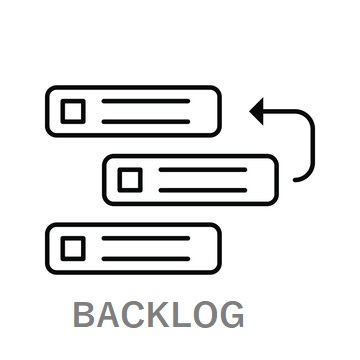

{width="30%"}

::: {.column-page-right}

##  ``Sprint#09: CompassMap React`` (9 - 13 November 2026)

| # | Day | Date | Topics |  Details Topics |
| -- | -- | -- | -- | -- |
| **#09** | 31 | 09/11/26 | - Plan Sprint#09     - React: follow Friday   - `.map()`   - Props   - Conditional render   - Vite | - [React Principles](/reactjs/reactjs-what-principles.qmd){.external target='_blank'}   - [Create project with Vite](/reactjs/rjslab7-1.qmd){.external target='_blank'}   - [Describing the UI](https://react.dev/learn/describing-the-ui){.external target='_blank'}   - [Passing props to a component](https://react.dev/learn/passing-props-to-a-component){.external target='_blank'}   - [Rendering lists](https://react.dev/learn/rendering-lists){.external target='_blank'}   - [filter](https://developer.mozilla.org/en-US/docs/Web/JavaScript/Reference/Global_Objects/Array/filter){.external target='_blank'} / [map](https://developer.mozilla.org/en-US/docs/Web/JavaScript/Reference/Global_Objects/Array/map){.external target='_blank'} / [object](https://developer.mozilla.org/en-US/docs/Web/JavaScript/Guide/Working_with_objects){.external target='_blank'} |
|  | 32 | 10/11/26 | - Spring Boot `compassMap`: follow `assessmentView` flow | - [CompassMap masterDoc v2](https://github.com/AlbertProfe/compassMap/blob/master/docs/compassMap_v2.md){.external target='_blank'}   - [Postman docs: CompassMap](https://documenter.getpostman.com/view/7473960/2sBYHSy1U9){.external target='_blank'}   - [assessmentview.json](https://github.com/AlbertProfe/compassMap/blob/master/docs/mockup/assessmentview.json){.external target='_blank'}   - [assessmentview-rest-v2](https://github.com/AlbertProfe/compassMap/blob/master/docs/appends/assessmentview-rest-v2.md){.external target='_blank'}   - [assessment-qa-rebuild-diagram](https://diagrammersamples.s3.eu-central-1.amazonaws.com/assessment-qa-rebuild-diagram.html){.external target='_blank'} |
|  |  | 11/11/26 | |  |
|  | 33 | 12/11/26 | - React: `useState`   - Axios | - [React Principles](/reactjs/reactjs-what-principles.qmd){.external target='_blank'}   - [Axios](https://axios-http.com/docs/intro){.external target='_blank'}   - [JavaScript in JSX with curly braces](https://react.dev/learn/javascript-in-jsx-with-curly-braces){.external target='_blank'}   - [Passing props to a component](https://react.dev/learn/passing-props-to-a-component){.external target='_blank'} |
|  | 34 | 13/11/26 | - React: `useState`   - Axios | - [React Principles](/reactjs/reactjs-what-principles.qmd){.external target='_blank'}   - [Axios](https://axios-http.com/docs/intro){.external target='_blank'}   - [JavaScript in JSX with curly braces](https://react.dev/learn/javascript-in-jsx-with-curly-braces){.external target='_blank'}   - [Passing props to a component](https://react.dev/learn/passing-props-to-a-component){.external target='_blank'} |

: Backlog course Sprint#09 November 2026 table {tbl-colwidths="[2,2,2,60,34]"}
:::

::: {.callout-note}
- `-` topic planned or done
- `----` topic pending to future
- `++` new topic not planned
:::
