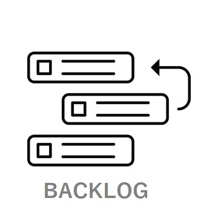

{width="30%"}

::: {.column-page-right}

##  ``Sprint#11: CompassMap React III`` (23 - 27 November 2026)

| # | Day | Date | Topics |  Details Topics |
| -- | -- | -- | -- | -- |
| **#11** | 39 | 23/11/26 | |  |
|  | 40 | 24/11/26 | |  |
|  |  | 25/11/26 | |  |
|  | 41 | 26/11/26 | |  |
|  | 42 | 27/11/26 | |  |

: Backlog course Sprint#11 November 2026 table {tbl-colwidths="[2,2,2,60,34]"}
:::

::: {.callout-note}
- `-` topic planned or done
- `----` topic pending to future
- `++` new topic not planned
:::
