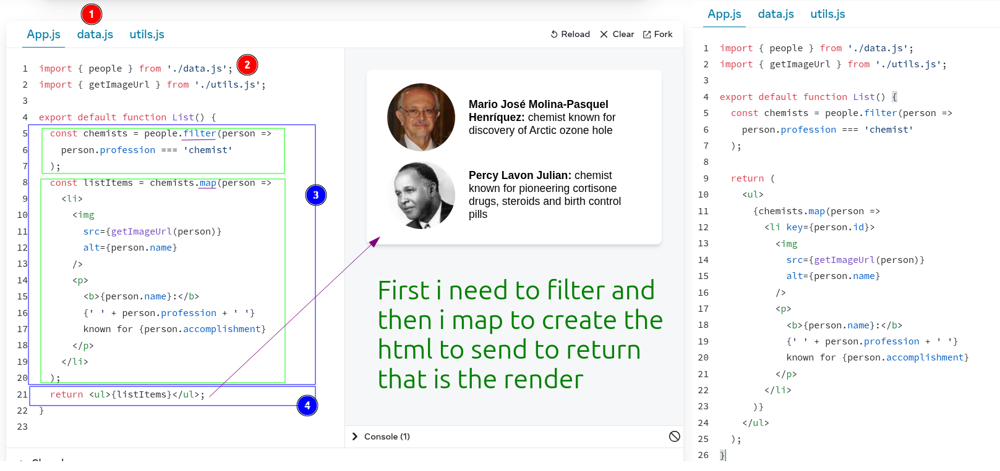
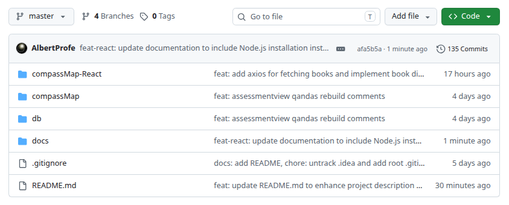
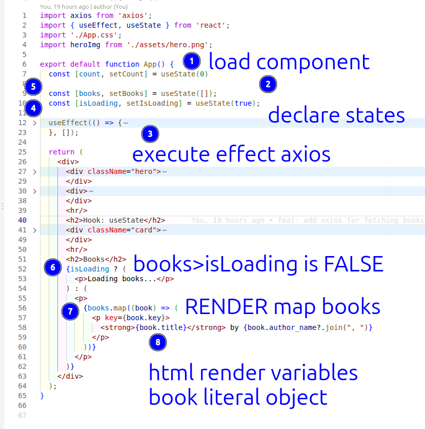
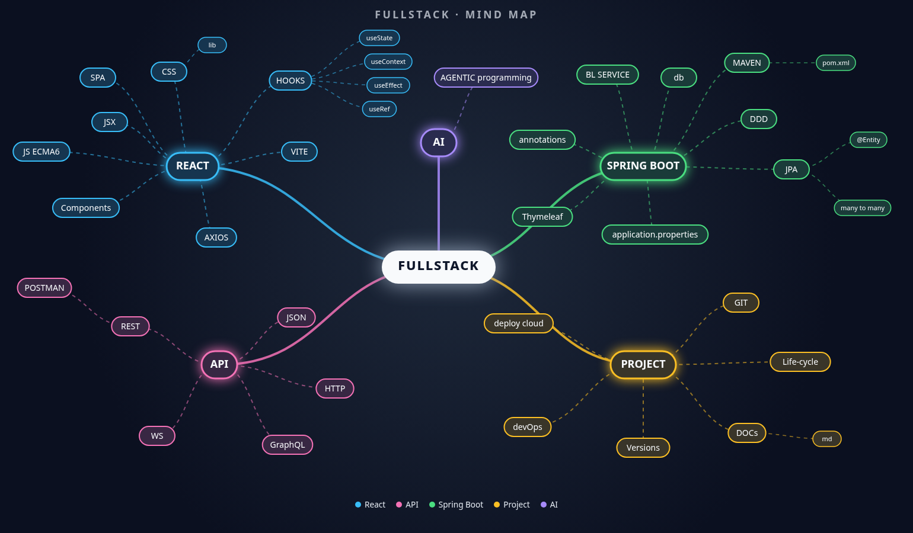
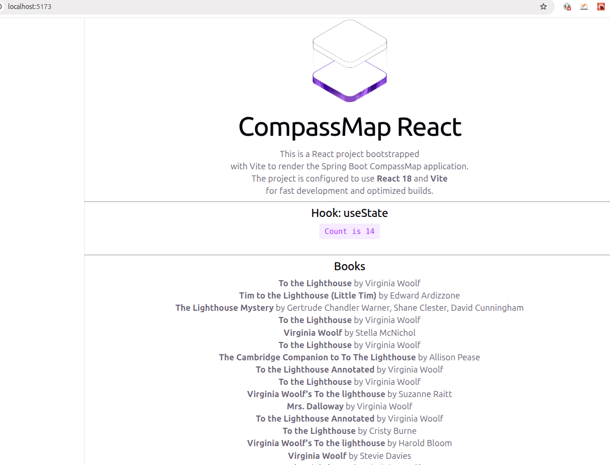
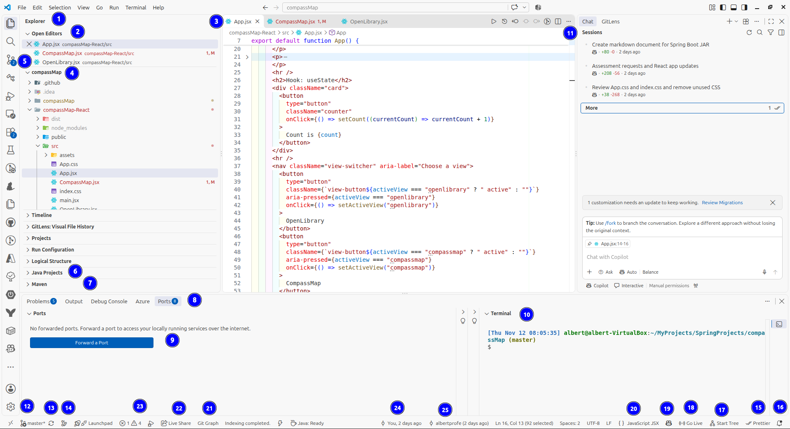
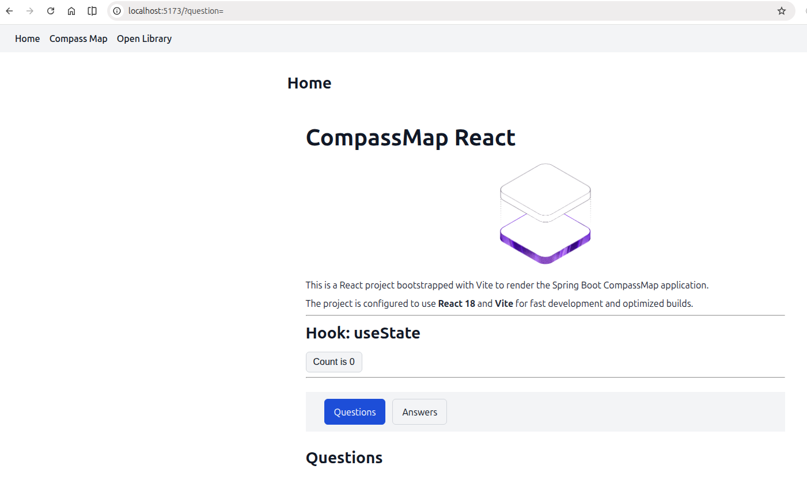

{width="30%"}

::: {.column-page-right}

##  ``Sprint#09: CompassMap React`` (9 - 13 November 2026)

| # | Day | Date | Topics |  Details Topics |
| -- | -- | -- | -- | -- |
| **#09** | 31 | 09/11/26 | - Plan Sprint#09     - Project: `compassMap-react`:   (1) create a React project with `Vite`   (2) define the UI mockup   (3) fetch `CompassMap` data with `Axios`   (4) build and run the project with npm, `App.jsx` and Vite   (5) create `React` components   (6) use `useState` and `useEffect`     - ApartmentPredictorReact **Reference**   (1) Mockup: define UI screens first   (2) Tree: project folder and components   (3) Flow: data from API to UI   (4) Deploy: build and publish app     ++ Introduction to **Render Cycle**: `useState` | - [React Principles](/reactjs/reactjs-what-principles.qmd){.external target='_blank'}   - [Create project](/reactjs/reactjs-what-create.qmd){.external target='_blank'}   - [Describing the UI](https://react.dev/learn/describing-the-ui){.external target='_blank'}   - [Passing props to a component](https://react.dev/learn/passing-props-to-a-component){.external target='_blank'}   - [Rendering lists](https://react.dev/learn/rendering-lists){.external target='_blank'}   - [filter](https://developer.mozilla.org/en-US/docs/Web/JavaScript/Reference/Global_Objects/Array/filter){.external target='_blank'} / [map](https://developer.mozilla.org/en-US/docs/Web/JavaScript/Reference/Global_Objects/Array/map){.external target='_blank'} / [object](https://developer.mozilla.org/en-US/docs/Web/JavaScript/Guide/Working_with_objects){.external target='_blank'}   {.lightbox width=100% fig-align="center"}   - [ApartmentPredictorReact](https://github.com/AlbertProfe/ApartmentPredictor-React){.external target='_blank'}   - [Tree visualizer](https://cassidoo.co/post/tree-visualizer/){.external target='_blank'} / [tree-tool](https://tree-tool.netlify.app/){.external target='_blank'}   - [useState](/reactjs/reactjs-hook-state.qmd){.external target='_blank'} / [useState react.dev](https://react.dev/learn/state-as-a-snapshot#rendering-takes-a-snapshot-in-time){.external target='_blank'}   - [Props and State](/reactjs/reactjs-what-props.qmd){.external target='_blank'}     - [React Days Infographic](https://diagrammersamples.s3.eu-central-1.amazonaws.com/ifcd0210-26-react-days.html){.external target='_blank'}   - [compassMap-Full: #9503de](https://github.com/AlbertProfe/compassMap/tree/9503dee063d9ce94edc1519b741ce309f732b0ee){.external target='_blank'} |
|  | 32 | 10/11/26 | - <s>`CompassMap` **JPA** `AssessmentView`: **flow**   (1) review the task requirements and data model   (2) implement the entity, repository and required relationships   (3) keep persistence entities separate from API/view models where appropriate   (4) add service and `@RestController` operations   (5) check relationship ownership and avoid unintended recursive JSON serialization </s>     - **Request/Response Cycle**:   (1) `Spring Boot` publishes an `API REST` and `React Vite` consumes it with `Axios`, and `map` renders the data   (2) `getAllAssessments` first stub     ++ `SPA` vs `MPA`   ++ `Google Inspector`: console, network, components   ++ Run `Spring Boot .jar` with console as our server   ++ Publish `React` render to Internet: `Port-Forwarding` at `Visual Code` | - [CompassMap masterDoc v2](https://github.com/AlbertProfe/compassMap/blob/master/docs/compassMap_v2.md){.external target='_blank'}   - [Postman docs: CompassMap](https://documenter.getpostman.com/view/7473960/2sBYHSy1U9){.external target='_blank'}   - [assessmentview.json](https://github.com/AlbertProfe/compassMap/blob/master/docs/mockup/assessmentview.json){.external target='_blank'}   - [assessmentview-rest-v2](https://github.com/AlbertProfe/compassMap/blob/master/docs/appends/assessmentview-rest-v2.md){.external target='_blank'}   - [assessment-qa-rebuild-diagram](https://diagrammersamples.s3.eu-central-1.amazonaws.com/assessment-qa-rebuild-diagram.html){.external target='_blank'}     - [compassMap-Full: #c80b4a](https://github.com/AlbertProfe/compassMap/tree/c80b4aeabef91607cad579f06a69e6c59abe4b3a){.external target='_blank'}   {.lightbox width=100% fig-align="center"}   - [README.md](https://github.com/AlbertProfe/compassMap/blob/master/README.md){.external target='_blank'}   {.lightbox width=100% fig-align="center"}   {.lightbox width=100% fig-align="center"}   {.lightbox width=100% fig-align="center"}   - [compassMap-Full: #a8e615](https://github.com/AlbertProfe/compassMap/tree/a8e615088cb0aa87c49ab73a9de0c652a3073eb2){.external target='_blank'}   - [Fullstack mind map](/images/ifcd0021-26/docs/fullstack-mindmap.html){.external target='_blank'} |
|  |  | 11/11/26 | |  |
|  | 33 | 12/11/26 | - React:   - `useState`: manage component local state   - `Axios`: fetch `REST API` data   - Create project with `Vite`, `npm`   - `Props` and `state`: data flow   - `Destructuring` `props` and `state` objects     - Project: `compassMap-react`:   (1) Mockup and Axios   (2) Flow feature `assessmentView`   (3) Navigation: `react-router-dom`   (4) Minimum `CSS` | - [React Principles](/reactjs/reactjs-what-principles.qmd){.external target='_blank'}   - [Axios](https://axios-http.com/docs/intro){.external target='_blank'}   - [`useState`](/reactjs/reactjs-hook-state.qmd){.external target='_blank'} / [useState react.dev](https://react.dev/learn/state-as-a-snapshot#rendering-takes-a-snapshot-in-time){.external target='_blank'}   - [Create project](/reactjs/reactjs-what-create.qmd){.external target='_blank'} / [vite](https://vite.dev/){.external target='_blank'}   - [Props and state](/reactjs/reactjs-what-props.qmd){.external target='_blank'}   - [Destructuring](/reactjs/reactjs-es6-destructuring.qmd){.external target='_blank'} / [JavaScript ES6](https://www.w3schools.com/js/js_es6.asp){.external target='_blank'}   - [Navigation: `react-router-dom`](/reactjs/reactjs-app-router.qmd){.external target='_blank'}     - [compassMap-Full: #a8e615](https://github.com/AlbertProfe/compassMap/tree/a8e615088cb0aa87c49ab73a9de0c652a3073eb2){.external target='_blank'}   - [Create .jar](https://github.com/AlbertProfe/compassMap/blob/master/docs/pipeline-deploy-cdci/TargetFolderAndBuildJar.md){.external target='_blank'} / [compassMap-React summary v1.1](https://github.com/AlbertProfe/compassMap/blob/master/docs/appends/compassMap-React-summary-v1.1.md){.external target='_blank'}   {.lightbox width=100% fig-align="center"}   - [compassMap-React_v1.md: #09faa1](https://github.com/AlbertProfe/compassMap/blob/09faa14253520e1828b5a33a083aaf155abcdda6/docs/compassMap-React_v1.md){.external target='_blank'}   - [compassMap-Full: #08f765](https://github.com/AlbertProfe/compassMap/tree/08f765b57005633b42317919db18d1972ff55fd6){.external target='_blank'}   - [React Practice Exercises for CompassMap](https://github.com/AlbertProfe/compassMap/blob/master/docs/pra/React%20Practice%20Exercises%20for%20CompassMap.md){.external target='_blank'}   {.lightbox width=100% fig-align="center"} |
|  | 34 | 13/11/26 | - React:   - `useState`: manage component local state   - `Axios`: fetch `REST API` data   - Create project with `Vite`, `npm`   - `Props` and `state`: data flow   - `useEffect`: side effects, data fetching     - Project: `compassMap-react`:   (1) Mockup and Axios | - [React Principles](/reactjs/reactjs-what-principles.qmd){.external target='_blank'}   - [Axios](https://axios-http.com/docs/intro){.external target='_blank'}   - [`useState`](/reactjs/reactjs-hook-state.qmd){.external target='_blank'} / [useState react.dev](https://react.dev/learn/state-as-a-snapshot#rendering-takes-a-snapshot-in-time){.external target='_blank'}   - [Create project](/reactjs/reactjs-what-create.qmd){.external target='_blank'} / [vite](https://vite.dev/){.external target='_blank'}   - [Props and state](/reactjs/reactjs-what-props.qmd){.external target='_blank'}   - [`useEffect`](/reactjs/reactjs-hook-effect.qmd){.external target='_blank'} |

: Backlog course Sprint#09 November 2026 table {tbl-colwidths="[2,2,2,60,34]"}
:::

::: {.callout-note}
- `-` topic planned or done
- `----` topic pending to future
- `++` new topic not planned
:::
