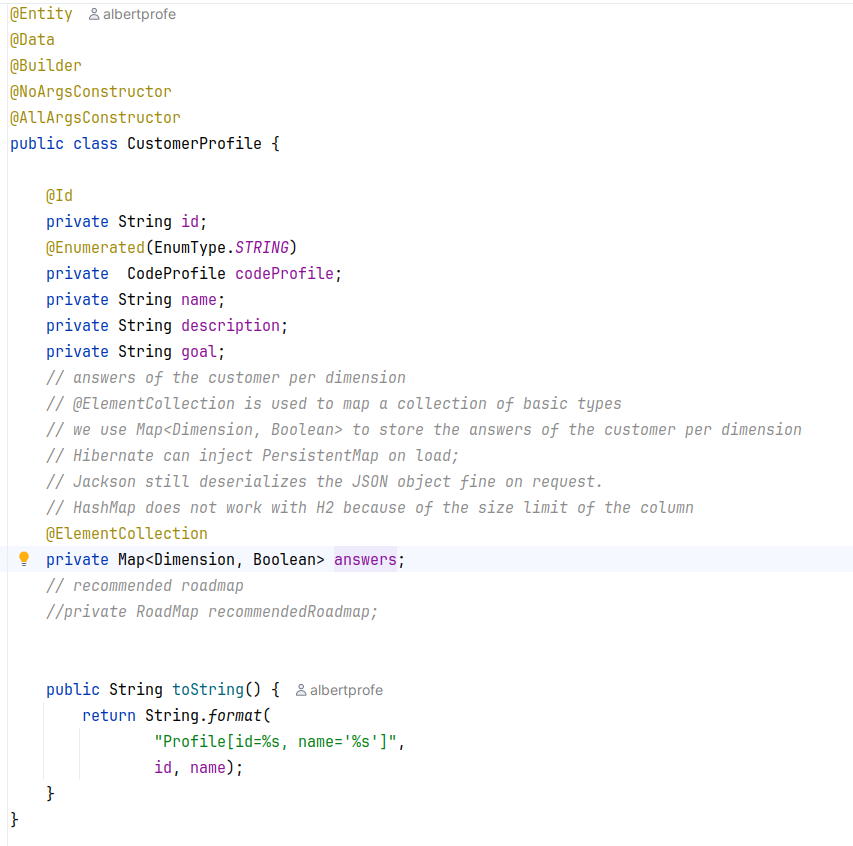
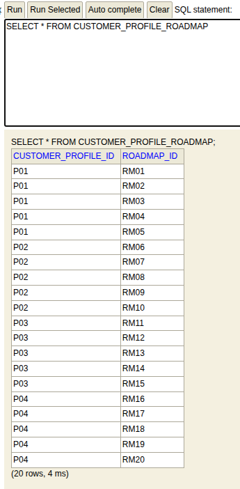
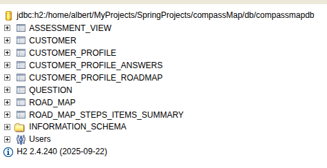
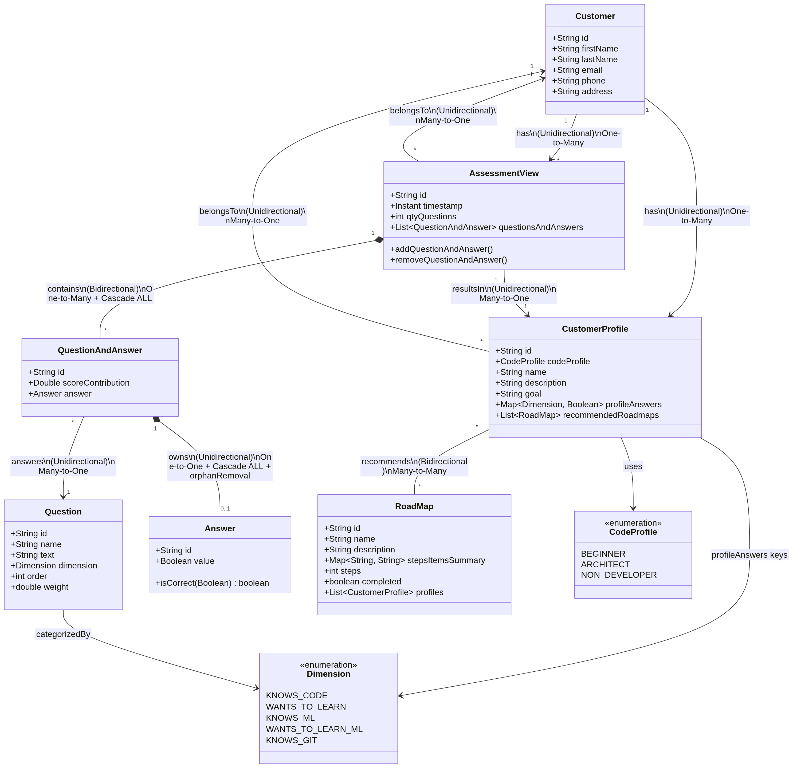

{width="30%"}

::: {.column-page-right}

##  ``Sprint#08: CompassMap JPA Tasks#2#3`` (2 - 6 November 2026)

| # | Day | Date | Topics |  Details Topics |
| -- | -- | -- | -- | -- |
| **#08** | 26 | 02/11/26 | - Plan Sprint#08     - `CompassMap` **project v2**:   (1) review the JPA data model   (2) focus on task#2: `CustomerProfile`   (3) define entity fields, identifiers, validation and relationship ownership   (4) update UML/data model before coding   (5) task#3     - Review JPA mappings: `@Entity`, `@OneToOne` and `@ManyToOne`   `@OneToMany` and `@ManyToMany`     ++ `HashMap`: what is it? `put`, `get` etc.   ++ `@ElementCollection` with a `Map<Dimension, Boolean>`: `CustomerProfile` answers per dimension | - [compassMap: 658893](https://github.com/AlbertProfe/compassMap/tree/65889308f4f2517e996226bf2bf61e200e14a2e5){.external target='_blank'}   - [CompassMap masterDoc v2](https://github.com/AlbertProfe/compassMap/blob/master/docs/compassMap_v2.md){.external target='_blank'}   - [JPA diagrams](https://github.com/AlbertProfe/compassMap/tree/65889308f4f2517e996226bf2bf61e200e14a2e5/docs/diagrams/JPA){.external target='_blank'}   - [JPA concepts](/springboot/boot-concepts-jpa-3.qmd){.external target='_blank'}     - [Java HashMap](https://www.w3schools.com/java/java_hashmap.asp){.external target='_blank'}   {.lightbox width=100% fig-align="center"} |
|  | 27 | 03/11/26 | - `CompassMap` JPA **task#2**: `CustomerProfile`   (1) implement the entity and its repository   (2) map its relationship to the existing customer/user model   (3) select unidirectional or bidirectional mapping based on navigation needs   <s>(4) add service and API operations</s>   <s>(5) verify create/read behavior and JSON response shape</s>     ++ Git: how to sync remote AlbertProfe to local Student     ++ `CustomerProfile` and `RoadMap`: `@ManyToMany`   ++ `@ElementCollection` with:   (1) `Map<String, String> stepsItemsSummary`   (2) `Map<Dimension, Boolean> profileAnswers` | - [CompassMap masterDoc v2](https://github.com/AlbertProfe/compassMap/blob/master/docs/compassMap_v2.md){.external target='_blank'}   - [JPA Relationships Guide](https://github.com/AlbertProfe/ApartmentPredictor/blob/master/docs/appends/JPA_Relationships_Guide.md){.external target='_blank'}   - [JPA relationships](/springboot/boot-concepts-jpa-3.qmd){.external target='_blank'}   - [Postman docs: CompassMap](https://documenter.getpostman.com/view/7473960/2sBYHSy1U9){.external target='_blank'}     - [task#2 commit, branch task2-profile](https://github.com/AlbertProfe/compassMap/tree/a99fe439e62dda97f396a65fb52f0c6f12c71c37){.external target='_blank'}   - [task#2 mockup data to test](https://github.com/AlbertProfe/compassMap/tree/a99fe439e62dda97f396a65fb52f0c6f12c71c37/docs/mockup){.external target='_blank'}   - [task#2 test: `DemoApplicationTests`](https://github.com/AlbertProfe/compassMap/blob/a99fe439e62dda97f396a65fb52f0c6f12c71c37/compassMap/src/test/java/com/example/demo/DemoApplicationTests.java#L89){.external target='_blank'}   - [`CustomerProfile`](https://github.com/AlbertProfe/compassMap/blob/a99fe439e62dda97f396a65fb52f0c6f12c71c37/compassMap/src/main/java/com/example/demo/model/CustomerProfile.java#L43){.external target='_blank'} / [`RoadMap`](https://github.com/AlbertProfe/compassMap/blob/a99fe439e62dda97f396a65fb52f0c6f12c71c37/compassMap/src/main/java/com/example/demo/model/RoadMap.java#L44){.external target='_blank'}     - [Git: sync remote AlbertProfe to local Student](https://gist.github.com/AlbertProfe/93791df0d9e2fcff5d7d693b13a6e5a9){.external target='_blank'}     {.lightbox width=100% fig-align="center"}   {.lightbox width=100% fig-align="center"} |
|  |  | 04/11/26 | |  |
|  | 28 | 05/11/26 | - `CompassMap` JPA **task#3**: `AssessmentView`   (1) review the task requirements and data model   (2) implement the entity, repository and required relationships   (3) keep persistence entities separate from API/view models where appropriate   (4) add service and `@RestController` operations   (5) check relationship ownership and avoid unintended recursive JSON serialization     - Test task#3: `assessmentView`     - UML: dataModel-v2 | - [CompassMap masterDoc v2](https://github.com/AlbertProfe/compassMap/blob/master/docs/compassMap_v2.md){.external target='_blank'}   - [JPA diagrams](https://github.com/AlbertProfe/compassMap/tree/65889308f4f2517e996226bf2bf61e200e14a2e5/docs/diagrams/JPA){.external target='_blank'}   - [JPA Relationships Implementation Rule](https://github.com/AlbertProfe/ApartmentPredictor/blob/master/docs/appends/JPA_RelationshipsImplementation_Rule.md){.external target='_blank'}   - [Postman docs: CompassMap](https://documenter.getpostman.com/view/7473960/2sBYHSy1U9){.external target='_blank'}     - [task#3 a69be4, branch task3-assesmentview](https://github.com/AlbertProfe/compassMap/tree/a69be4ad7737bcae481a8b862246946e2e5a7f41){.external target='_blank'}   - [dataModel-v2](https://github.com/AlbertProfe/compassMap/blob/a69be4ad7737bcae481a8b862246946e2e5a7f41/docs/appends/dataModel-v2.md){.external target='_blank'}   - [Gist test assessmentView](https://gist.github.com/AlbertProfe/9f6877aa4f6f111bb3dd870a4c8bcb67){.external target='_blank'}   - [assessmentview.json](https://github.com/AlbertProfe/compassMap/blob/master/docs/mockup/assessmentview.json){.external target='_blank'}   - [compassMap a8b9a51](https://github.com/AlbertProfe/compassMap/tree/a8b9a51c80e28ef4fdbfd2bb1f3e93012dbf6e78){.external target='_blank'}   - [assessmentview-rest-v2](https://github.com/AlbertProfe/compassMap/blob/a8b9a51c80e28ef4fdbfd2bb1f3e93012dbf6e78/docs/appends/assessmentview-rest-v2.md){.external target='_blank'}     {.lightbox width=100% fig-align="center"}   - [assessment-qa-rebuild-diagram](https://diagrammersamples.s3.eu-central-1.amazonaws.com/assessment-qa-rebuild-diagram.html){.external target='_blank'} / [updated](https://github.com/AlbertProfe/compassMap/blob/master/docs/appends/assessmentview-rest-v2.md){.external target='_blank'} |
|  | 29 | 06/11/26 | - React: introduction   - React MOOC: React Lean   - Describing the UI: **JSX** and what is a **component**     - Project: `compassMap-react`:   (1) create a React project with Vite   (2) define the UI mockup   (3) fetch CompassMap data with Axios   (4) build and run the project with npm, `App.jsx` and Vite   (5) create React components   (6) use `useState` and `useEffect`     - Focus: JSX **curly braces** for JavaScript expressions   (1) pass and read **props**   (2) render data collections with `.map()`   (3) use a stable `key` for each rendered item | - [React Principles](/reactjs/reactjs-what-principles.qmd){.external target='_blank'}   - [Create React App](/reactjs/reactjs-what-create.qmd){.external target='_blank'}   - [Create project with Vite](/reactjs/rjslab7-1.qmd){.external target='_blank'}   - [Describing the UI](https://react.dev/learn/describing-the-ui){.external target='_blank'}   - [JavaScript in JSX with curly braces](https://react.dev/learn/javascript-in-jsx-with-curly-braces){.external target='_blank'}   - [Passing props to a component](https://react.dev/learn/passing-props-to-a-component){.external target='_blank'}   - [Rendering lists](https://react.dev/learn/rendering-lists){.external target='_blank'}   - [Axios](https://axios-http.com/docs/intro){.external target='_blank'} |

: Backlog course Sprint#08 November 2026 table {tbl-colwidths="[2,2,2,60,34]"}
:::

::: {.callout-note}
- `-` topic planned or done
- `----` topic pending to future
- `++` new topic not planned
:::
