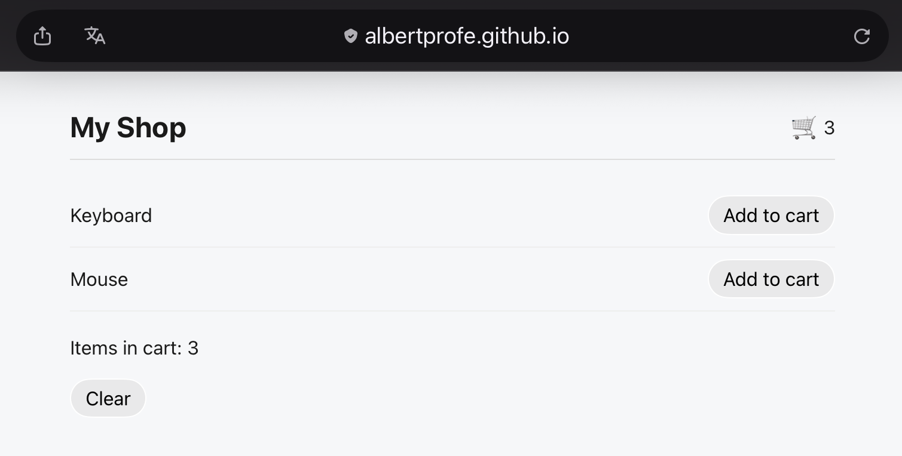
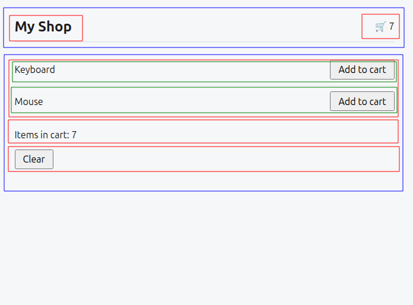
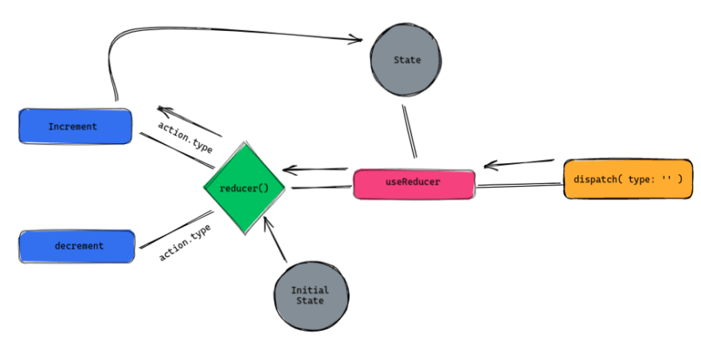
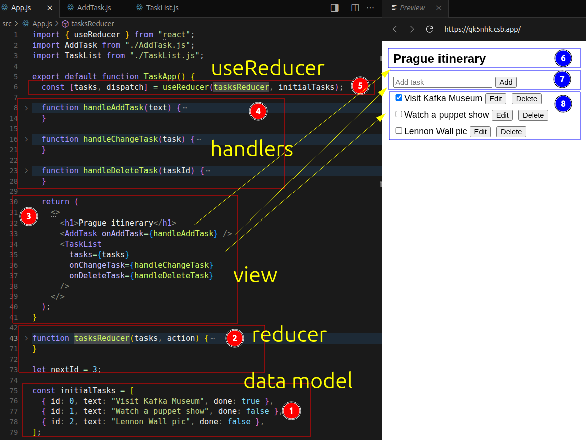
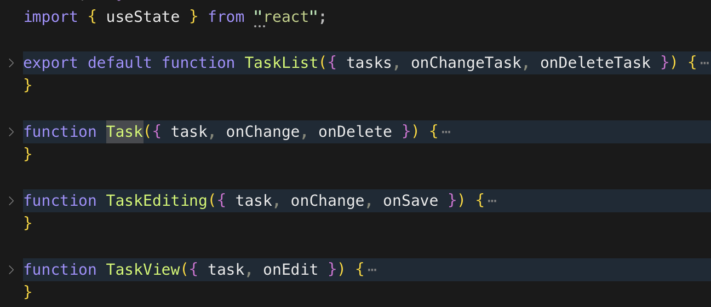

{width="30%"}

::: {.column-page-right}

##  ``Sprint#11: CompassMap React III`` (23 - 27 November 2026)

| # | Day | Date | Topics |  Details Topics |
| -- | -- | -- | -- | -- |
| **#11** | 39 | 23/11/26 | - Plan Sprint#11     - React: `Context` & `useContext`   (1) Sharing state: lifting state up vs `Context`   (2) `createContext`, `Provider`, `useContext`     - React: `sculptures` + `Context` + `Neon` API   - `SculpturesContext.jsx`: the 5 elements, part 1   (1) `SculptureApiService`: `Neon` REST calls (`getAll`, `create`, `remove`)   (2) `createContext`: `SculpturesContext`   (3) `SculpturesProvider`: state (`useState`) + load with `useEffect`     - Project: `cartShoppingContext` v0.1   (1) `createContext`: `CartContext`   (2) `CartProvider`: state (`useState`) for `count`   (3) Consumers via `useCart`: `Product` (Add to cart), `CartBadge` (items count), `CartSummary` (Clear) | - [Sharing State Between Components](https://react.dev/learn/sharing-state-between-components){.external target='_blank'} / [Passing Data Deeply with Context](https://react.dev/learn/passing-data-deeply-with-context){.external target='_blank'} / [`createContext`](https://react.dev/reference/react/createContext){.external target='_blank'}   - [`useContext`](/reactjs/reactjs-hook-context.qmd){.external target='_blank'} / [Props: passing props down, state up](/reactjs/reactjs-what-props.qmd#example-passing-props-down-state-up){.external target='_blank'}   - [Ex#1](https://daveceddia.com/usecontext-hook/){.external target='_blank'} / [Ex#2](https://www.w3schools.com/react/react_usecontext.asp){.external target='_blank'} / [Ex#3: Cart Shopping Context](/reactjs/rjslab8-1.qmd){.external target='_blank'}   - [cartShoppingContext](https://github.com/AlbertProfe/cartShoppingContext){.external target='_blank'} / [cartShoppingContext: #471851](https://github.com/AlbertProfe/cartShoppingContext/tree/471851d88da4cd173821dfe301237cc06d6ba956){.external target='_blank'} / [Live demo](https://albertprofe.github.io/cartShoppingContext/){.external target='_blank'}   {.lightbox width=100% fig-align="center"}     - [Sculptures Wiki: Backend Neon](https://github.com/AlbertProfe/sculptures/wiki/Backend:-Neon){.external target='_blank'} / [sculptures: neon-api-rest branch](https://github.com/AlbertProfe/sculptures/tree/neon-api-rest){.external target='_blank'}   - [`SculpturesContext.jsx`](https://github.com/AlbertProfe/sculptures/blob/neon-api-rest/sculptures/src/SculpturesContext.jsx){.external target='_blank'} / [sculptures: #50f67b](https://github.com/AlbertProfe/sculptures/tree/50f67bd04ba573bfe420484555d33bb060af8561){.external target='_blank'}     {.lightbox width=100% fig-align="center"} |
|  | 40 | 24/11/26 | - React: `Context` & `useContext`: follow Monday     <s>- React: `sculptures` + `Context` + `Neon` API</s>   <s>- `SculpturesContext.jsx`: the 5 elements, part 2</s>   <s>(4) Actions: `addSculpture`, `removeSculpture` → Provider `value`</s>   <s>(5) Custom hook `useSculptures()`: `useContext` + guard outside Provider</s>   <s>- Consumers: `SculpturesPage`, `SculpturesAdd`, `SculpturesRemove`, `SculpturesFilteredByYear`</s>     - Project: `cartShoppingContext` v0.2   (1) reducer: `useReducer` (`cartReducer` + `initialCart`)   (2) `CartProvider`: state (`items` `{id, name, qty, price}`) + `dispatch` (`add`, `remove`, `clear`)   (3) Consumers via `useCart`: `Product` (Add), `CartBadge` (`cartQty`), `CartSummary` (lines, `cartTotal`, Clear)     ++ `useReducer`: what it is? how does it work?   ++ `state`, `dispatch`, `reducer` and flow | - [Sharing State Between Components](https://react.dev/learn/sharing-state-between-components){.external target='_blank'} / [Passing Data Deeply with Context](https://react.dev/learn/passing-data-deeply-with-context){.external target='_blank'} / [`createContext`](https://react.dev/reference/react/createContext){.external target='_blank'}   - [`useContext`](/reactjs/reactjs-hook-context.qmd){.external target='_blank'} / [Props: passing props down, state up](/reactjs/reactjs-what-props.qmd#example-passing-props-down-state-up){.external target='_blank'}   - [Custom hooks](/reactjs/reactjs-hook-custom.qmd){.external target='_blank'} / [Reusing Logic with Custom Hooks](https://react.dev/learn/reusing-logic-with-custom-hooks){.external target='_blank'}     - [Sculptures Wiki: Backend Neon](https://github.com/AlbertProfe/sculptures/wiki/Backend:-Neon){.external target='_blank'} / [sculptures: neon-api-rest branch](https://github.com/AlbertProfe/sculptures/tree/neon-api-rest){.external target='_blank'}   - [`SculpturesContext.jsx`](https://github.com/AlbertProfe/sculptures/blob/neon-api-rest/sculptures/src/SculpturesContext.jsx){.external target='_blank'} / [sculptures: #50f67b](https://github.com/AlbertProfe/sculptures/tree/50f67bd04ba573bfe420484555d33bb060af8561){.external target='_blank'}     - [`useReducer`](/reactjs/reactjs-hook-reducer.qmd){.external target='_blank'}   - [Lab#RE08-2: Cart Shopping Context with useReducer](/reactjs/rjslab8-2.qmd){.external target='_blank'}   - [cartShoppingContext](https://github.com/AlbertProfe/cartShoppingContext){.external target='_blank'} / [cartShoppingContext: #ee6e00](https://github.com/AlbertProfe/cartShoppingContext/tree/ee6e008b4a05a6157edd73fd21e5b251dcfe7bb7){.external target='_blank'}     {.lightbox width=100% fig-align="center"}     {.lightbox width=100% fig-align="center"}   - [Extracting State Logic into a Reducer](https://react.dev/learn/extracting-state-logic-into-a-reducer){.external target='_blank'} / [Scaling Up with Reducer and Context](https://react.dev/learn/scaling-up-with-reducer-and-context){.external target='_blank'}   - [Prague Itinerary Component Tree](/images/ifcd0021-26/docs/prague-itinerary-component-tree.html){.external target='_blank'} / [Prague Itinerary: Live demo](https://gk5nhk.csb.app/){.external target='_blank'}     {.lightbox width=100% fig-align="center"} |
|  |  | 25/11/26 | |  |
|  | 41 | 26/11/26 | - PROVA Objectiva i Pràctica     - Deliver: `zips` | - [IFCD0021-26 Calendar & Deliveries](/ifcd0021-26/ifcd0021-deliveries-26.qmd){.external target='_blank'} |
|  | 42 | 27/11/26 | - Project: `compassMap` fullstack   (1) New flow: Business Logic for `assessmentView`   (2) `@Service`: new method   (3) `@RestController`: new endpoint   (4) React: new component using `Context`   (5) `Axios`: call the new endpoint | - [compassMap-Full: #7ade8f](https://github.com/AlbertProfe/compassMap/tree/7ade8f5efac884259ee0ea780a87f8efe2ccbc0d){.external target='_blank'}   - [assessmentview-rest-v2](https://github.com/AlbertProfe/compassMap/blob/master/docs/appends/assessmentview-rest-v2.md){.external target='_blank'} / [assessment-qa-rebuild-diagram](https://diagrammersamples.s3.eu-central-1.amazonaws.com/assessment-qa-rebuild-diagram.html){.external target='_blank'}   - [Spring Boot: Controller](/springboot/boot-concepts-controller.qmd){.external target='_blank'} / [Spring Boot: Rest](/springboot/boot-concepts-rest.qmd){.external target='_blank'}   - [`useContext`](/reactjs/reactjs-hook-context.qmd){.external target='_blank'} / [Axios](https://axios-http.com/docs/intro){.external target='_blank'} |

: Backlog course Sprint#11 November 2026 table {tbl-colwidths="[2,2,2,60,34]"}
:::

::: {.callout-note}
- `-` topic planned or done
- `----` topic pending to future
- `++` new topic not planned
:::
