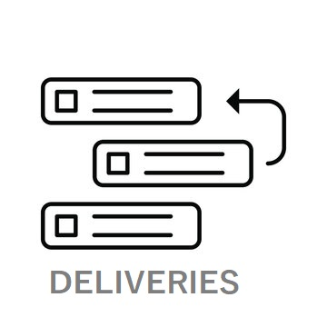
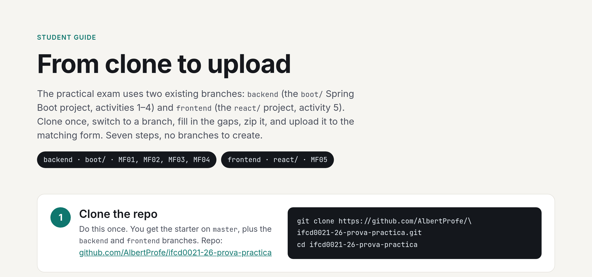

{width="30%"}

# Calendar 2026

- **Inici-final de curs**: 14/09/2026-27/11/2026 (11 setmanes de 3/4 dies lectius)
- **Dimecres**: tots els dimecres són NO-Lectius
- Horari: 8:30-14:30


{.lightbox width=80% fig-align="center"}

# Ponderació de les avaluacions i de la prova final

La nota final del curs es calcularà amb la següent ponderació:

| Avaluacions        | Ponderació |
| ------------------ | ---------- |
| Avaluació contínua | 30%        |
| Avaluació final    | 70%        |
|    - Teoria          | 30%        |
|    - Pràctica         | 70%        |

> Per tant, la **Avaluació final** tindrà un pes del 70% de la nota final del curs, i es dividirà en una part teòrica (30%) i una part pràctica (70%).

Ponderació de la Avaluació final:

- La **part pràctica** és un 70% del 70% de la nota final del curs, per tant te un pes del <mark>49% de la nota final del curs</mark>.
- La **part teòrica** és un 30% del 70% de la nota final del curs, per tant te un pes del <mark>21% de la nota final del curs</mark>.

| Avaluacions        | Ponderació |
| ------------------ | ---------- |
| Avaluació contínua | 30%        |
| Teoria             | 21%        |
| Pràctica           | 49%        |

# Deliveries

Always in **Quarto/Wiki .md format** and code in GitHub **repositories** (or Organizations)

- **via github**
- uploading a zip via Google Forms
- email to alberprofe
- or similar

Deliveries:

- [MF01-02-03 Deliveries](https://forms.gle/rkAXo279ktYZcMC27){.external target='_blank'}
- [MF04-05 Deliveries](https://forms.gle/Tyf6cw2JsTZaZxb88){.external target='_blank'}

# Prova pràctica: student guide

::: {.column-margin}
<a href="../images/ifcd0021-26/docs/student-guide/Main.dc.html" class="external" target="_blank"></a>
:::

The prova pràctica uses two existing branches in a GitHub repo. Clone once and switch to a branch — do not create one.

- **Repo.** [AlbertProfe/ifcd0021-26-prova-practica](https://github.com/AlbertProfe/ifcd0021-26-prova-practica){.external target='_blank'} (private for now, and public on 26/11/2026 at 08:00).
- **Branches.**
  - `backend` (`boot/`): activities 1–4 — MF01 Git, MF02, MF03, and MF04, including REST and Postman
  - `frontend` (`react/`): activity 5 / MF05
- **doc/ folder.** On each branch, add a `doc/` folder at the repo root with a Markdown file for notes and screenshots. On `backend`, put the public Postman collection link in that file, not on the exam paper.
- **Zip names.** Commit first, then zip with `git archive` (no accents; the `-1` is required):

  ```
  MF01-03_PP_Nom_Cognom1_Cognom2-1.zip
  MF04-05_PP_Nom_Cognom1_Cognom2-1.zip
  ```

- **Upload / forms.** Upload each zip to the matching form on this page, in the Prova Pràctica field.
- **MF04.** MF04 is graded from the backend zip.

[Open the student guide](../images/ifcd0021-26/docs/student-guide/Main.dc.html){.external target='_blank'}
