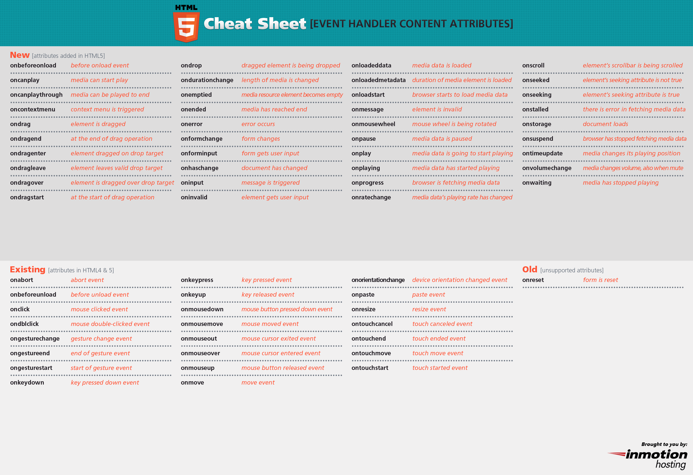

## Overview

::: {.summary}

📘 **DOM and events**
When the browser loads a page it turns the HTML into the **DOM** (Document Object Model): a **tree of objects** that JavaScript can read and change. **Events** are things that happen to those objects (a click, a key, a submit), and JavaScript can **react** to them.

React does all this for us (it updates the DOM and wires the events), but under the hood it is exactly the same DOM and the same events.

:::

---

## What is the DOM?

The HTML is just text. The browser parses it and builds a tree of **nodes**:

``` html
<html>
  <body>
    <h1 id="title">Shop</h1>
    <ul class="products">
      <li>Keyboard</li>
      <li>Mouse</li>
    </ul>
  </body>
</html>
```

```
document
 └── html
      └── body
           ├── h1#title  ── "Shop"
           └── ul.products
                ├── li ── "Keyboard"
                └── li ── "Mouse"
```

With the **HTML DOM**, JavaScript can:

- find elements,
- change their **content**, **attributes** and **styles**,
- **add and remove** elements,
- **react to events** on them.

::: {.callout-tip}
## The DOM is slow-ish, React helps
Changing the real DOM is expensive. React keeps a **virtual DOM** in memory and only touches the real DOM where something changed. See [React JS: render virtual DOM](/reactjs/reactjs-what-render-dom.qmd).
:::

## Selecting and changing elements

``` {.javascript .code-overflow-wrap filename="app.js"}
// by id: one element (or null)
const title = document.getElementById("title");

// by CSS selector: the first match
const list = document.querySelector(".products");
const firstItem = document.querySelector(".products li");

// by CSS selector: all matches (a NodeList)
const items = document.querySelectorAll(".products li");
items.forEach((li) => console.log(li.textContent));

// change content, attributes and style
title.textContent = "My shop";
title.setAttribute("data-version", "2");
title.style.color = "tomato";
list.classList.add("highlight");

// create and add a new element
const li = document.createElement("li");
li.textContent = "Monitor";
list.appendChild(li);
```

| Method                          | Returns                               |
|---------------------------------|---------------------------------------|
| `getElementById("id")`          | The element with that `id`, or `null` |
| `querySelector("css")`          | The **first** element matching        |
| `querySelectorAll("css")`       | **All** matching elements (NodeList)  |
| `getElementsByClassName("c")`   | Live collection by class              |
| `getElementsByTagName("p")`     | Live collection by tag                |

: Selecting elements {.striped .hover}

::: {.callout-note}
## `textContent` vs `innerHTML`
`textContent` sets plain text. `innerHTML` parses HTML, so never put user input in it: it opens the door to XSS attacks. React escapes text for you by default.
:::

## How events work

### What is an event?

**HTML events are things that happen to HTML elements**, caused by the user or by the browser:

- a button is **clicked**,
- the page has **finished loading**,
- the mouse **moves over** an element,
- a **key** is pressed,
- an input field **changes**,
- a form is **submitted**.

JavaScript can **react to these events**: we register a function (an **event handler** or **listener**) and the browser calls it when the event happens.

### Option 1: event attributes (`on...`)

::: {.column-margin}
<a href="/images/reactjs/html5-cheatsheet-events.png" class="external" target="_blank" rel="noopener"></a>

HTML5 event attributes cheat sheet (InMotion Hosting)
:::


The oldest way: put JavaScript in an `on<event>` attribute of the element.

``` {.html .code-overflow-wrap filename="index.html"}
<button onclick="showDate()">What time is it?</button>
<p id="demo"></p>

<script>
  function showDate() {
    document.getElementById("demo").innerHTML = Date();
  }
</script>
```

The attribute value is a **string of JavaScript code**, here a call to `showDate()`.

| Event         | When it fires                                          |
|---------------|--------------------------------------------------------|
| `onclick`     | The user clicks an element                             |
| `onchange`    | The value of an input/select changed (and lost focus)  |
| `oninput`     | The value of an input changes, on every keystroke      |
| `onsubmit`    | A form is submitted                                    |
| `onkeydown`   | The user presses a key                                 |
| `onmouseover` | The mouse pointer moves onto an element                |
| `onmouseout`  | The mouse pointer moves out of an element              |
| `onfocus` / `onblur` | An element gets / loses focus                   |
| `onload`      | The page (or an image) has finished loading            |

: Common HTML events {.striped .hover}

### Option 2: `addEventListener()` (recommended in plain JS)

Keep HTML clean and attach the handler from JavaScript:

``` {.javascript .code-overflow-wrap filename="app.js"}
const button = document.getElementById("myBtn");

function sayHello() {
  alert("Hello World!");
}

button.addEventListener("click", sayHello);   // no "on" prefix: "click", not "onclick"
// button.removeEventListener("click", sayHello);
```

`element.addEventListener(event, function, useCapture)`:

- the first parameter is the event **type** (`"click"`, `"input"`, `"submit"`, `"keydown"`...), **without** `on`,
- the second is the **function** to call (we pass the function, we don't call it: `sayHello`, not `sayHello()`),
- the third (optional) chooses capturing instead of bubbling.

Advantages: you can add **many handlers** to the same element without overwriting each other, JS stays **separated from the markup**, and you can **remove** them with `removeEventListener()`.

### The event object

The browser passes an **event object** to the handler with all the details of what happened:

``` {.javascript .code-overflow-wrap filename="app.js"}
const input = document.getElementById("name");

input.addEventListener("input", (event) => {
  console.log(event.type);          // "input"
  console.log(event.target);        // the element that fired the event
  console.log(event.target.value);  // what the user typed
});

document.addEventListener("keydown", (event) => {
  console.log("Key pressed:", event.key);
});
```

### `event.preventDefault()`

Some events have a **default browser action**: a link navigates, a submit button sends the form and **reloads the page**. `preventDefault()` cancels it so JavaScript can handle things itself:

``` {.javascript .code-overflow-wrap filename="app.js"}
const form = document.querySelector("form");

form.addEventListener("submit", (event) => {
  event.preventDefault();                 // no page reload
  const data = new FormData(form);
  console.log("Hello", data.get("name"));
});
```

### Bubbling and capturing

When you click a `<button>` inside a `<div>`, the event first fires on the **button** and then **bubbles up** to its parents: the `div`, the `body`, the `document`. That is why a click handler on a parent also runs when you click a child.

``` html
<div onclick="console.log('div')">
  <button onclick="console.log('button')">Click</button>
</div>
<!-- Clicking the button logs: "button" then "div" -->
```

Call `event.stopPropagation()` if you want the event to stop at the current element.

::: {.callout-note}
## Capturing
Bubbling goes from the inner element outwards. The opposite direction, from the outer element inwards, is called **capturing**; you get it with `addEventListener("click", fn, true)`. Bubbling is the default and the one you'll use almost always.
:::

### Event delegation

Thanks to bubbling, we don't need a listener on every child. We put **one listener on the parent** and check `event.target`:

``` {.javascript .code-overflow-wrap filename="app.js"}
const list = document.querySelector(".products");

list.addEventListener("click", (event) => {
  const li = event.target.closest("li");   // the <li> that was clicked (or null)
  if (!li) return;
  li.classList.toggle("selected");
  console.log("Clicked:", li.textContent);
});
```

Advantages: **one** listener instead of hundreds, and it also works for `<li>` elements **added later**.

::: {.column-margin}
React uses delegation itself: it attaches its listeners to the root container of the app, not to every button.
:::

## Events in React

The same events, written in camelCase and receiving a function:

``` {.jsx .code-overflow-wrap filename="Button.jsx"}
export default function Button() {
  function handleClick(event) {
    console.log("Clicked", event.target);
  }
  return <button onClick={handleClick}>Click me</button>;
}
```

More in [From HTML to JSX](/reactjs/reactjs-what-html-jsx.qmd) and [React JS App: events](/reactjs/reactjs-app-events.qmd).

::: {.callout-note}
## HTML for React
[1. HTML basics](/reactjs/reactjs-what-html.qmd) · [2. Forms](/reactjs/reactjs-what-html-forms.qmd) · **3. Events and the DOM** · [4. From HTML to JSX](/reactjs/reactjs-what-html-jsx.qmd) · [5. CSS basics](/reactjs/reactjs-what-html-css.qmd)

⬅️ Previous: [HTML forms](/reactjs/reactjs-what-html-forms.qmd) · Next ➡️ [From HTML to JSX](/reactjs/reactjs-what-html-jsx.qmd)
:::

## References

- [W3Schools: JavaScript HTML DOM](https://www.w3schools.com/js/js_htmldom.asp){.external}
- [W3Schools: JavaScript HTML DOM Elements](https://www.w3schools.com/js/js_htmldom_elements.asp){.external}
- [W3Schools: JavaScript HTML DOM Events](https://www.w3schools.com/js/js_htmldom_events.asp){.external}
- [W3Schools: JavaScript Events](https://www.w3schools.com/js/js_events.asp){.external}
- [W3Schools: JavaScript addEventListener()](https://www.w3schools.com/js/js_htmldom_eventlistener.asp){.external}
- [W3Schools: HTML Event Attributes](https://www.w3schools.com/tags/ref_eventattributes.asp){.external}
- [W3Schools: preventDefault()](https://www.w3schools.com/jsref/event_preventdefault.asp){.external} and [stopPropagation()](https://www.w3schools.com/jsref/event_stoppropagation.asp){.external}
- [React: Responding to Events](https://react.dev/learn/responding-to-events){.external}
