## Pure Components

### Stateful/Stateless Components 

> Sateful Components: Functions that internally modify the underlying data (props).

```{.jsx .code-overflow-wrap filename="profile.jsx"}
function Hello({ name }) {
  //...
  return (
    <>
     <h1>Hello {name + ' - ' + (new Date()).toLocaleString()}!!!</h1>;
    </>
  )
}

export default function Hello() {
  //...
  return (
   <Hello name="World" />
  )
}
```

> Stateless Components: ``Pure components`` that respond to the underlying data received (``props``), without modifying it.

A ``pure function`` is a function where the return value is only determined by its input values, without observable side effects.

```{.jsx .code-overflow-wrap filename="Hello.jsx"}
function Hello({ name }) {
  //...
  return (
    <>
     <h1>Hello {name}!!!</h1>;
    </>
  )
}

export default function Hello() {
  //...
  return (
   <Hello name="World" />
  )
}
```

### Keep Components Pure

::: {.callout-important}
Writing pure functions takes a bit of practice, but it unlocks the power of React’s paradigm
:::


By strictly only [writing](https://react.dev/learn/keeping-components-pure){.external} your components as ``pure functions``, **you can avoid an entire class of baffling bugs and unpredictable behavior as your codebase grows**. To get these benefits, though, there are a few rules you must follow.

- Rendering can happen at any time, so components **should not depend on** each others’ rendering sequence.
- You **should not mutate any of the inputs that your components use for rendering**. That includes props, state, and context. To update the screen, “set” state instead of mutating preexisting objects.
- Strive **to express your component’s logic in the JSX you return**. When you need to “change things”, you’ll usually want to do it in an event handler. As a last resort, you can useEffect.


**React’s rendering process must always be pure.** Components should only return their JSX, and not change any objects or variables that existed before rendering—that would make them impure!

Here is a component **that breaks this rule**:


```{.jsx .code-overflow-wrap filename="Hello.jsx"}
let guest = 0;

function Cup() {
  // Bad: changing a preexisting variable!
  guest = guest + 1;
  return <h2>Tea cup for guest #{guest}</h2>;
}

export default function TeaSet() {
  return (
    <>
      <Cup />
      <Cup />
      <Cup />
    </>
  );
}
```
::: {.column-margin}
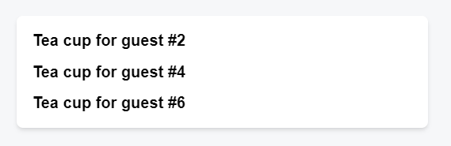{width=100%}
:::

[Detecting impure calculations with StrictMode](https://react.dev/learn/keeping-components-pure#detecting-impure-calculations-with-strict-mode){.external}

::: {.callout-note}
## Rendering must always be a pure calculation
- Same inputs, same output.
- It minds its own business.
  
Otherwise, you can encounter **confusing bugs and unpredictable behavior as your codebase grows in complexity**.

When developing in `Strict Mode`, **React calls each component’s function twice**, which can help surface mistakes caused by impure functions.
:::


## What is state and rendering: update/render cycle

::: {.column-margin}
[React Render Cycle](https://diagrammersamples.s3.eu-central-1.amazonaws.com/React-Render-Cycle.html){.external target="_blank"}

An interactive diagram of the trigger, render, and commit steps.

[Render Cycle Playground](https://diagrammersamples.s3.eu-central-1.amazonaws.com/Render_Cycle_Playground.html){.external target="_blank"}

An interactive playground to trigger a state update and watch React render, diff, and commit to the DOM.

<a href="/images/reactjs/render-cycle-playground.png" class="external" target="_blank" rel="noopener">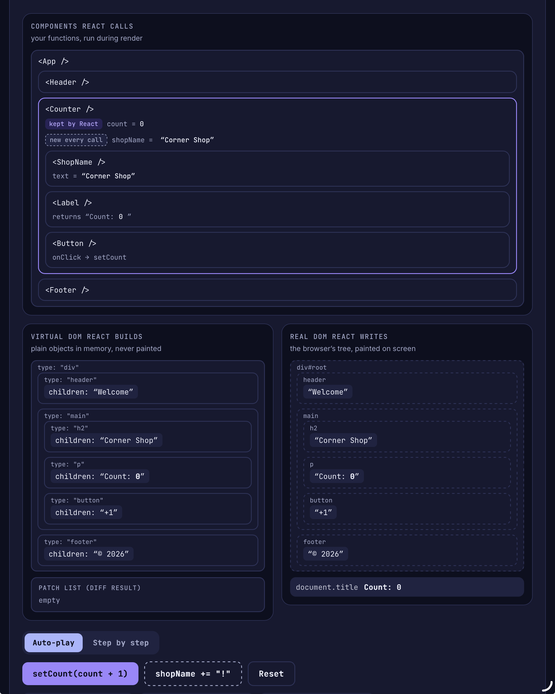</a>

Render Cycle Playground: Components, Virtual DOM, and Real DOM
:::

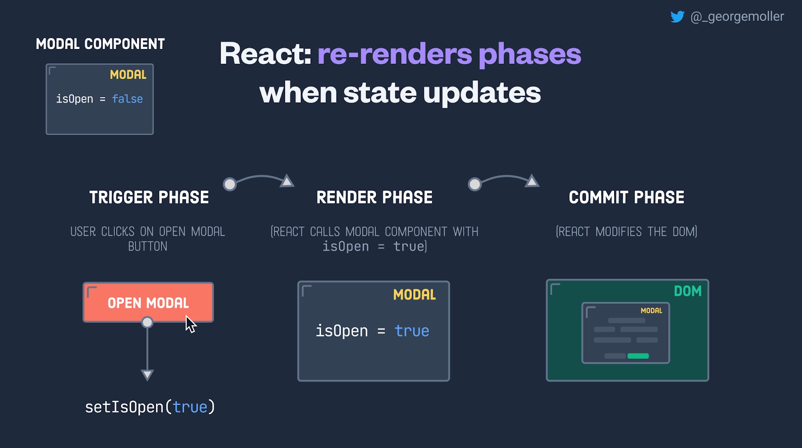{width="80%"}

[State variables](https://beta.reactjs.org/learn/state-as-a-snapshot#setting-state-triggers-renders){.external} might look like regular JavaScript variables that you can read and write to.

> **However, state behaves more like a snapshot**.

Setting it **does not change** the state variable you already have, [but instead triggers a re-render](https://beta.reactjs.org/learn/render-and-commit#step-1-trigger-a-render){.external} that will print a state variable copy with the new value.

::: {.callout-important}
State can hold any kind of JavaScript value, including objects.

But you shouldn’t change objects that you hold in the React state directly.

Instead, when you want to update an object, you need to create a new one (or make a copy of an existing one), and then set the state to use that copy.
:::

[How it works in combination with spread opearator](/reactjs/reactjs-es6-spread.qmd#copying-objects-with-the-spread-syntax)  
[And what is a hook: useState](/reactjs/reactjs-hook-state.qmd)

> **Treat state as read-only**: in other words, you should treat any JavaScript object that you put into state as read-only.

``` {.jsx .code-overflow-wrap filename="App.js"}
import { useState } from 'react';

export default function Counter() {
  const [number, setNumber] = useState(0);

  return (
    <>
      <button onClick={() => {
        setNumber(number++);
      }}>+1</button>

      <h1>{number}</h1>
    </>
  )
}

```

::: {.column-margin}
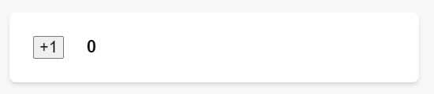{width=100%}
:::

::: {.column-margin}
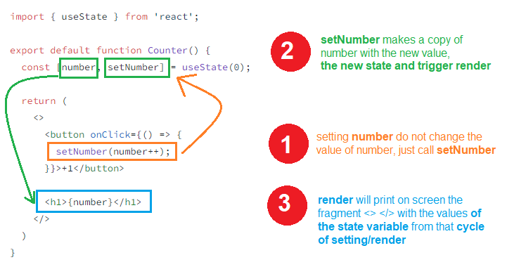{width=100%}
:::

::: {.column-margin}
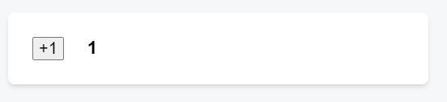{width=100%}
:::

### update/render behaviour

Any screen update in a React app happens **in three steps:**

1. Trigger
2. Render
3. Paint-Commit

::: {.column-margin}
You can use `Strict Mode` to find mistakes in your components
React does not touch the DOM if the rendering result is the same as last time
:::

[After](https://react.dev/learn/render-and-commit#step-3-react-commits-changes-to-the-dom){.external} rendering (calling) your components, React will modify the `DOM`.

> **React only changes the DOM nodes if there’s a difference between renders**.

For example, here is a component that re-renders with different props passed from its parent every second. Notice how you can add some text into the `<input>`, updating its value, but **the text doesn’t disappear** when the component re-renders:

```js
export default function Clock({ time }) {
  return (
    <>
      <h1>{time}</h1>
      <input />
    </>
  );
}
```

::: {.column-margin}
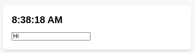{width=100%}
:::


## So, Is React immutable?

The term **immutable** refers **to the idea that the state of a component should not be changed directly.** Instead, when the state of a component needs to be updated, a new copy of the state should be created with the desired changes applied.

This approach to state management can help <mark>to ensure that the state of a React application is predictable and easy to understand, as it makes it clear how the state is changing over time.</mark>

It can also make it easier to debug issues in your application, as you can more easily trace the history of the state and see how it has changed.

### And then, what is a mutation?

You can store any kind of JavaScript value in state.

```{.jsx .code-overflow-wrap filename="Hello.jsx"}
const [x, setX] = useState(0);
```

So far you’ve been working with numbers, strings, and booleans. These kinds of JavaScript values are *immutable*, meaning unchangeable or *read-only*. **You can trigger a re-render to replace a value:**

```{.jsx .code-overflow-wrap filename="Hello.jsx"}
setX(5);
```

The ``x`` *state changed from 0 to 5*, but the number ``0`` itself did not change. It’s not possible to make **any changes to the built-in primitive values** like numbers, strings, and booleans in JavaScript.

Now consider an object in state:

```{.jsx .code-overflow-wrap filename="Hello.jsx"}
const [position, setPosition] = useState({ x: 0, y: 0 });
```

Technically, it is possible to change the contents of the object itself. This is called a **mutation**:

```{.jsx .code-overflow-wrap filename="Hello.jsx"}
position.x = 5;
```

<mark>However, although objects in React state are technically mutable, you should treat them as if they were immutable—like numbers, booleans, and strings. Instead of mutating them, you should always **replace** them.<mark>

## Examples

### Example 1: setting state only changes it for the next render

[In this example](https://beta.reactjs.org/learn/queueing-a-series-of-state-updates#react-batches-state-updates){.external}, you might expect that clicking the ``+3`` button would increment the counter three times because it calls ``setNumber(number + 1)`` three times.

``` {.jsx .code-overflow-wrap filename="App.js"}
import { useState } from 'react';

export default function Counter() {
  const [number, setNumber] = useState(0);

  return (
    <>
      <h1>{number}</h1>
      <button onClick={() => {
        setNumber(number + 1);
        setNumber(number + 1);
        setNumber(number + 1);
      }}>+3</button>
    </>
  )
}
```

::: {.column-margin}
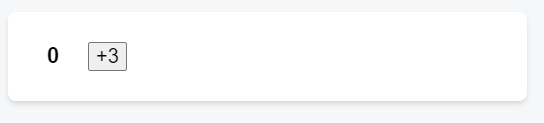{width=100%}
:::

::: {.column-margin}
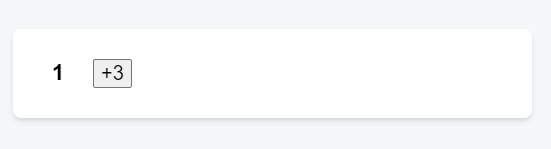{width=100%}
:::

::: {.column-margin}
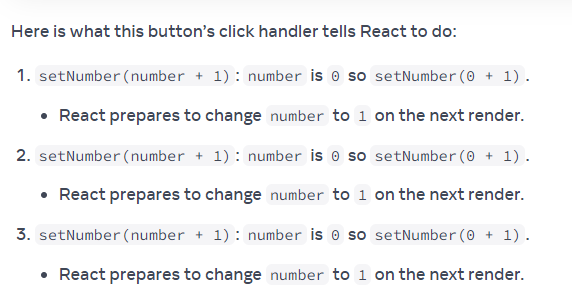{width=100%}
:::

::: {.callout-important}
## Number is a state variable, not a regular variable
**Setting state only changes it for the next render**. During the first render, ``number`` was ``0``. 

And this is like this because number is ... **a state.**

So, during execution lines #10, #11 and #12, **``number`` value is ...0!**
:::


[This is why](https://beta.reactjs.org/learn/queueing-a-series-of-state-updates#react-batches-state-updates){.external}, in that render’s ``onClick handler``, the value of ``number`` is still ``0`` even after ``setNumber(number + 1)`` was called .. **three times!!!**


### Example 2: State over time 

[State over time](https://beta.reactjs.org/learn/state-as-a-snapshot#state-over-time){.external}, step by step how setting and render do not happen at same moment.


``` {.jsx .code-overflow-wrap filename="App.js"}
import { useState } from 'react';

export default function Counter() {
  const [number, setNumber] = useState(0);

  return (
    <>
      <h1>{number}</h1>
      <button onClick={() => {
        setNumber(number + 5);
        alert(number);
      }}>+5</button>
    </>
  )
}

```

::: {.column-margin}
{width=100%}
:::

::: {.column-margin}
{width=100%}
:::

::: {.column-margin}
{width=100%}
:::

> Alert is helping us to understand why **setting and render are two different moments**

Setting ``number`` state to 5, but first React will execute line #11, alert, and ``number`` state **still** is 0


### Example 3: email

Here is an example of **how that makes your event handlers less prone to timing mistakes**. Below is a form that sends a message with a **five-second delay**. Imagine this scenario:

1. You press the ``Send`` button, sending *Hello* to **Alice**.
2. Before the **five-second delay ends**, you change the value of the ``To`` field to **Bob**.

``` {.jsx .code-overflow-wrap filename="App.js"}
import { useState } from 'react';

export default function Form() {
  const [to, setTo] = useState('Alice');
  const [message, setMessage] = useState('Hello');

  function handleSubmit(e) {
    e.preventDefault();
    setTimeout(() => {
      alert(`You said ${message} to ${to}`);
    }, 5000);
  }

  return (
    <form onSubmit={handleSubmit}>
      <label>
        To:{' '}
        <select
          value={to}
          onChange={e => setTo(e.target.value)}>
          <option value="Alice">Alice</option>
          <option value="Bob">Bob</option>
        </select>
      </label>
      <textarea
        placeholder="Message"
        value={message}
        onChange={e => setMessage(e.target.value)}
      />
      <button type="submit">Send</button>
    </form>
  );
}
```

::: {.column-margin}
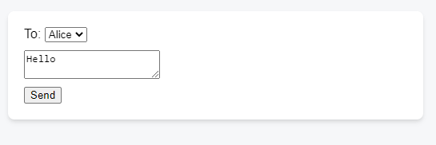{width=100%}
:::

::: {.column-margin}
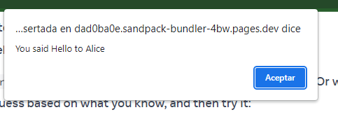{width=100%}
:::

React keeps the state values *fixed* within **one render’s event handlers**.

You don’t need to worry whether the state has changed while the code is running.

### Example 4: state updater function

It is an uncommon use case, but if you would like to update the same state variable multiple times before the next render, instead of passing the next state value like ``setNumber(number + 1)``, you can pass a function that calculates the next state based on the previous one in the queue, like ``setNumber(n => n + 1)``.

It is a way to tell React to **do something with the state value instead of just replacing it.**

``` {.jsx .code-overflow-wrap filename="App.js"}
import { useState } from 'react';

export default function Counter() {
  const [number, setNumber] = useState(0);

  return (
    <>
      <h1>{number}</h1>
      <button onClick={() => {
        setNumber(n => n + 1);
        setNumber(n => n + 1);
        setNumber(n => n + 1);
      }}>+3</button>
    </>
  )
}
```

::: {.column-margin}
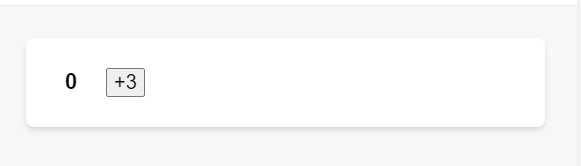{width=100%}
:::

::: {.column-margin}
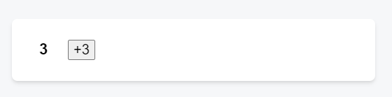{width=100%}
:::

See also: [React JS: properties](/reactjs/reactjs-what-props.qmd).
