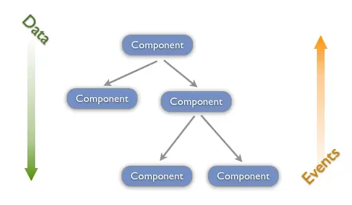

::: {.summary}

📘 **Props**

**React components** use **props** (``props`` stands for **properties**) to communicate with each other.

Every parent component **can pass some information to its child components by giving them props**.

Props might remind you of HTML attributes, but you can pass any JavaScript value through them, including objects, arrays, and functions.

:::

</br>

{width="70%"}

In ``React JS``, data flows in one direction, **from Parent to Child**. This helps components to be **simple and predictable**.

::: {.column-margin}
> “Simplicity is the ultimate sophistication.” -Leonardo da Vinci
:::

For state, the render cycle, and immutability, see [React JS: render cycle](/reactjs/reactjs-what-immutability.qmd).

## Overview

In React.js, "``props``" (**short for "properties"**) are used **to pass data from one component to another**. Props are passed as an object (which is similar to a JSON object) and contain key-value pairs of data: 

- ``JSON`` is a lightweight data interchange format that is easy to read and write for both humans and machines.
-  ``props`` is a reserved keyword that refers to an object containing all the properties (or props) passed to a component.

For example, let's say we have a component called **MyComponent** that receives an object named ``person`` as a ``prop``. This ``person`` ``object`` might look like this:

```js
const person = {
  name: 'John',
  age: 30,
  address: {
    street: '123 Main St',
    city: 'Anytown',
    state: 'CA',
    zip: '12345'
  }
};
```
In this case, the ``person`` ``object`` contains some key-value pairs and another object. We can then pass this ``person`` ``object`` as a prop to our **MyComponent** component like this:

```js
<MyComponent person={person} />

```

Inside **MyComponent**, we can access the ``person`` ``prop`` using the props object like this:

```js
function MyComponent(props) {
  console.log(props.person.name); // 'John'
  console.log(props.person.age); // 30
  console.log(props.person.address.street); // '123 Main St'
  // ...
}

```
### Example1

```js
const car = {
  make: 'Toyota',
  model: 'Corolla',
  year: 2022,
  color: 'blue'
};

const person = {
  name: 'John',
  age: 30,
  address: {
    street: '123 Main St',
    city: 'Anytown',
    state: 'CA',
    zip: '12345'
  }
};

<MyComponent person={person} car={car} />

function MyComponent(props) {
  console.log(props.person.name); // 'John'
  console.log(props.person.age); // 30
  console.log(props.person.address.street); // '123 Main St'

  console.log(props.car.make); // 'Toyota'
  console.log(props.car.model); // 'Corolla'
  console.log(props.car.year); // 2022
  console.log(props.car.color); // 'blue'
  // ...
}

```

### Example2


Use the same syntax as HTML attributes to send props into a component:

```{.js .code-overflow-wrap filename="profile.jsx"}
function Avatar({ person, size }) {
  // person and size are available here
}
```

```{.js .code-overflow-wrap filename="lin.jsx"}
export default function Lin() {
  return (
    <Avatar
      person={{ name: 'Lin Lanying', imageId: '1bX5QH6' }}
      size={100}
    />
  );
}
```

```{.js .code-overflow-wrap filename="carla.jsx"}
export default function Carla() {
  return (
    <Avatar
      person={{ name: 'Carla Lan', imageId: 'KIU3QH1' }}
      size={60}
    />
  );
}
```


## The ``children`` prop

``children`` is a **special prop**: whatever you nest between a component’s opening and closing tags is passed to that component as ``children``.

A wrapper component receives that nested JSX and can render it inside its own markup.

Without [destructuring](/reactjs/reactjs-es6-destructuring.qmd), you read it from the ``props`` object: ``props.children``.

With object ``destructuring``, you can pull ``children`` (and any other props) out of the ``props`` object in the function parameter:

```{.jsx .code-overflow-wrap filename="Card.jsx"}
function Card({ children, title }) {
  return (
    <section>
      <h2>{title}</h2>
      {children}
    </section>
  );
}
```

This is the same idea as:

```{.jsx .code-overflow-wrap filename="Card.jsx"}
function Card(props) {
  return (
    <section>
      <h2>{props.title}</h2>
      {props.children}
    </section>
  );
}
```

You then nest content inside ``Card`` like this:

```{.jsx .code-overflow-wrap filename="App.jsx"}
<Card title="Profile">
  <Avatar person={person} size={100} />
</Card>
```

See also: [React JS: render cycle](/reactjs/reactjs-what-immutability.qmd).
