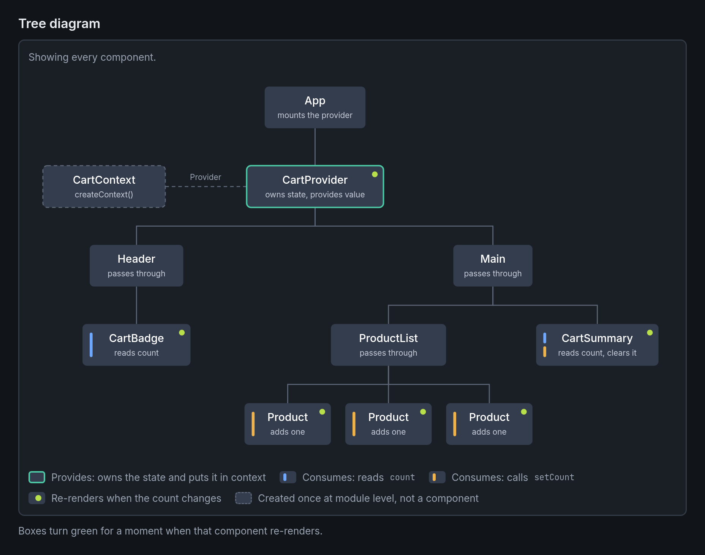
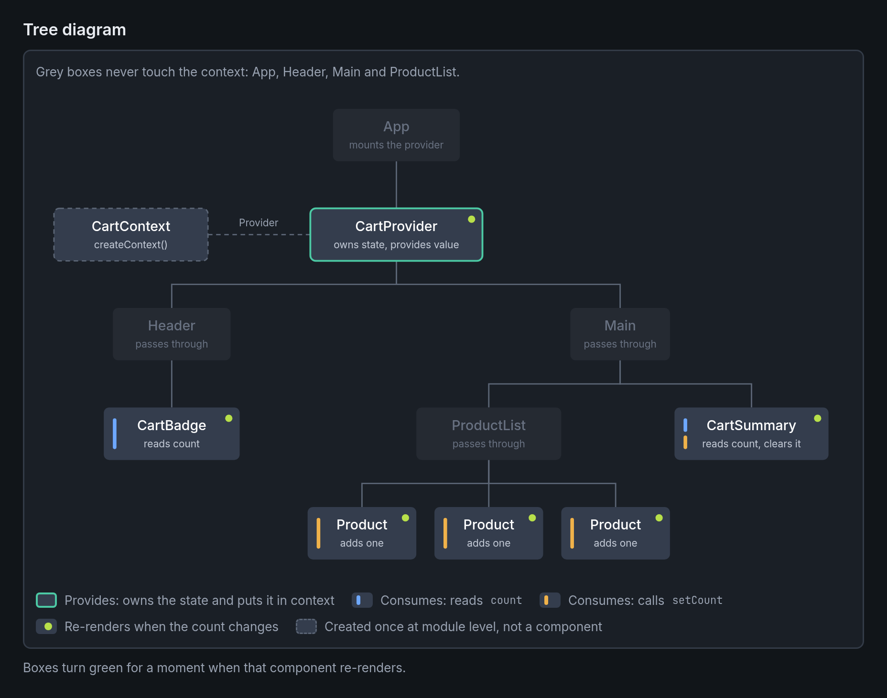
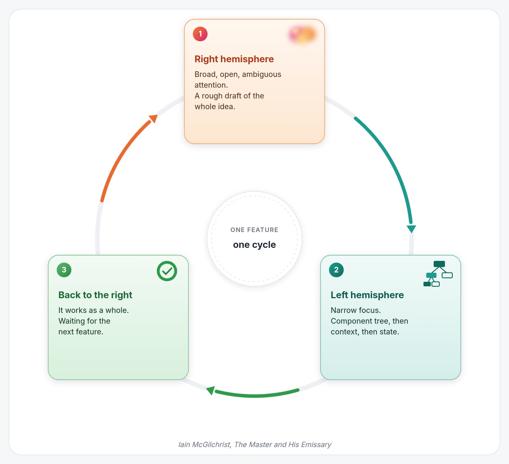
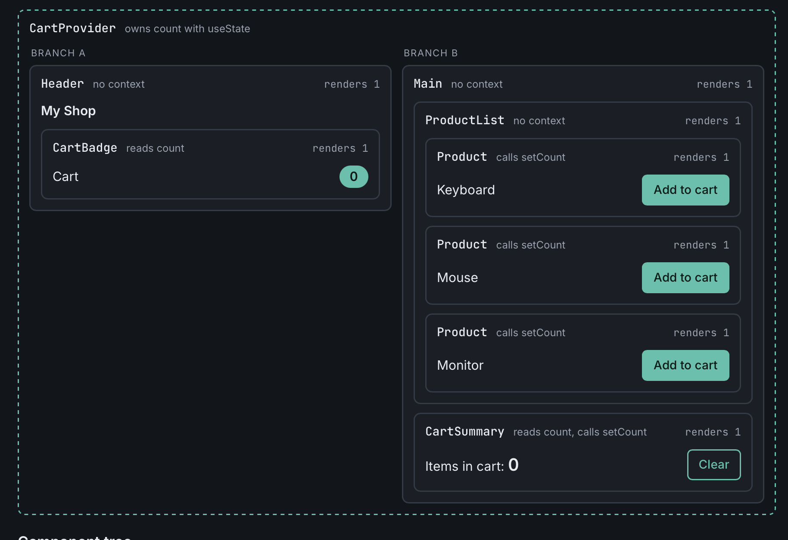
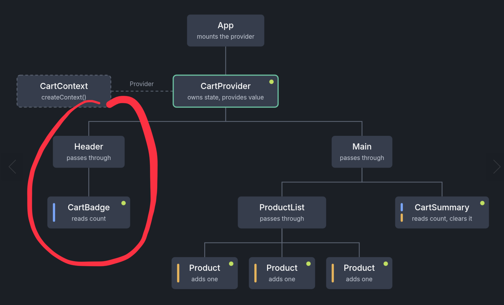
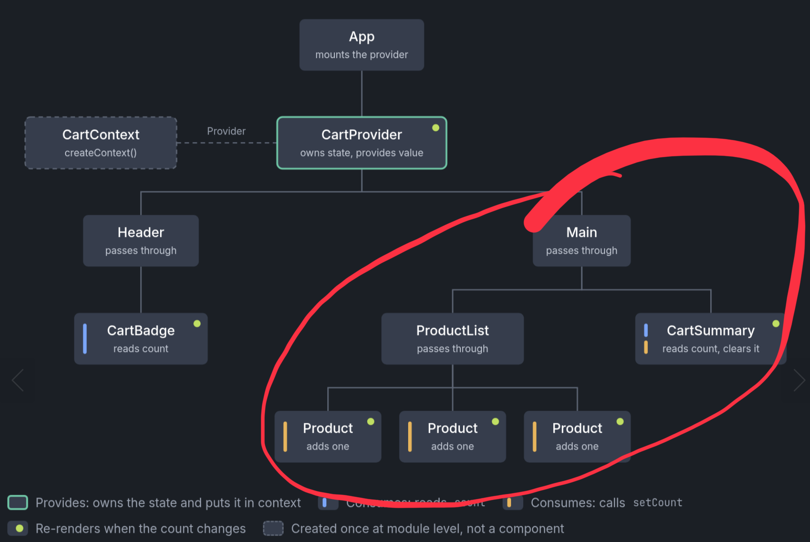
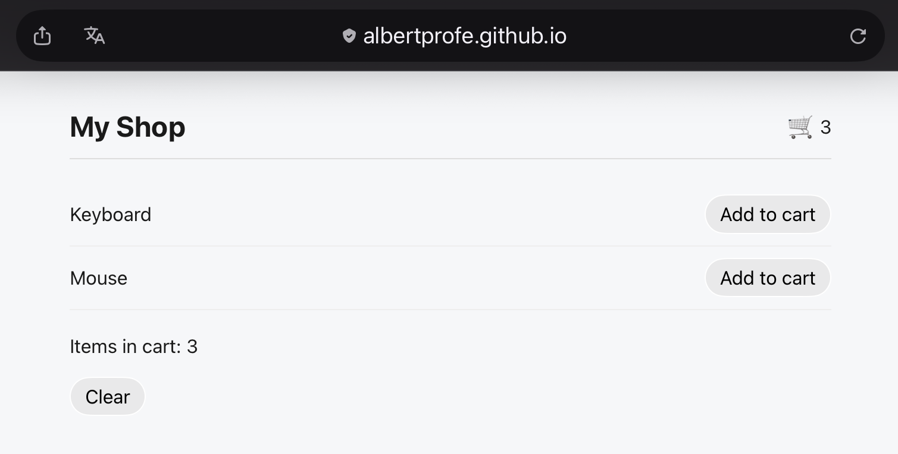

::: {.labs}
📘 **React JS Lab#RE08-1: Cart Shopping Context**

In this lab, we'll build a small **shop** with React to see how **context** works. The project is **Cart Shopping Context**.

Here's an overview of what we'll cover:

1. **Project Setup**: we'll create a new React project with **Vite**.
2. **Context API**: we'll create a `CartContext`, wrap the tree in a `CartProvider` that owns the state, and read or update that state from components in two different branches.
3. **A custom hook**: a small `useCart` hook keeps the consumers tidy.
4. **No prop drilling**: `Product` and `CartBadge` share the cart count without passing props through `Header`, `Main`, or `ProductList`.


By the end of this lab, you'll have a working shop where **Add to cart** in the main column updates the badge in the header, and you'll know *why* that works.

:::

</br>

::: {.panel-tabset}

### All components {.unnumbered .unlisted}

{.lightbox width=100% fig-align="center"}

### Context only {.unnumbered .unlisted}

{.lightbox width=100% fig-align="center"}

:::

[Open the interactive Cart Context Demo](/images/reactjs/docs/cart-context-visuals.html){.external target='_blank'}

The diagrams above are the component tree. Use the tabs to see which components never touch the context. The demo is the same diagram, live: boxes flash when that component re-renders.

::: {.column-margin}
[*The Master and His Emissary*](https://yalebooks.yale.edu/book/9780300245929/the-master-and-his-emissary/){.external target='_blank'}, by Iain McGilchrist (Yale University Press, 2009). Two kinds of attention: the right for the whole, the left for the parts.
:::

::: {.callout-note}
## The method

Before we write a line of code, it helps to see the method this lab follows. Iain McGilchrist, in *The Master and His Emissary*, is not making a pop-psychology claim about "left brain versus right brain". He is describing two kinds of attention, and we keep passing the work between them.

We start with the **right hemisphere's** kind of attention: broad, open, and a little ambiguous. The feature is still a rough draft of the whole app — a shop where "Add to cart" updates a badge in the header. We can feel the idea without pinning every part down.

Then we switch to the **left hemisphere's** kind of attention: narrow and focused. We break the idea into a component tree, then into context and state. The tabs above are that move. **All components** is the full tree; **Context only** greys out the parts that never touch the cart, so you can see who owns or consumes the state.

When the pieces fit, we come **back to the right**. The shop works as a whole again and waits for the next feature. Then the cycle repeats: another vague idea, another careful breakdown, another working whole.
:::

{.lightbox width=100% fig-align="center"}

# References

- [React JS: useContext](/reactjs/reactjs-hook-context.qmd)
- [React JS: useReducer](/reactjs/reactjs-hook-reducer.qmd)
- [`useContext`](https://react.dev/reference/react/useContext){.external target='_blank'}
- [Passing Data Deeply with Context](https://react.dev/learn/passing-data-deeply-with-context){.external target='_blank'}
- [React JS: Create a React project — Vite](/reactjs/reactjs-what-create.qmd#create-a-project-with-vite)
- GitHub repo: [AlbertProfe/cartShoppingContext](https://github.com/AlbertProfe/cartShoppingContext){.external target='_blank'}

# Create project

## Vite

> Next Generation Frontend Tooling: Get ready for a development environment that can finally catch up with you.

- [Vite](https://vite.dev/){.external target='_blank'}
- [Create a project with Vite](/reactjs/reactjs-what-create.qmd#create-a-project-with-vite)

To create a new Vite project, open your terminal and run:

```{.sh .code-overflow-wrap filename="bash.sh"}
npm create vite@latest cartShoppingContext -- --template react
cd cartShoppingContext
npm install
npm run dev
```

The React team **deprecated Create React App in February 2025**. For new React apps, Vite is the recommended starting point.

This lab's scaffold is **v0.0** on the GitHub repo: [cartShoppingContext v0.0](https://github.com/AlbertProfe/cartShoppingContext/tree/57ffeac96443444802bce8cd91afd69dd1254e9f){.external target='_blank'}

# Project tree

Each component lives in its own folder. The context and the hook have their own folders too; there is no single shared `components/` bag.

```{.sh .code-overflow-wrap filename="tree"}
src/
  App.jsx
  main.jsx
  context/CartContext.jsx    # createContext + CartProvider
  hooks/useCart.js
  Header/Header.jsx
  CartBadge/CartBadge.jsx
  Main/Main.jsx
  ProductList/ProductList.jsx
  Product/Product.jsx
  CartSummary/CartSummary.jsx
```

The shop lists two products: **Keyboard** and **Mouse**.

# Step-by-step code

This is **v0.1**: the cart example, split into those folders. [cartShoppingContext v0.1](https://github.com/AlbertProfe/cartShoppingContext/tree/471851d88da4cd173821dfe301237cc06d6ba956){.external target='_blank'}

::: {.column-margin}
{.lightbox}

[Open the interactive Cart Context Demo](/images/reactjs/docs/cart-context-visuals.html){.external target='_blank'}
:::

## Create the context

`CartContext` is created once at **module level**. It is not a component. `CartProvider` owns the state — a `count` held in `useState(0)` — and exposes `{ count, setCount }` through the provider.

``` {.jsx .code-overflow-wrap filename="src/context/CartContext.jsx"}
import { createContext, useState } from "react";

export const CartContext = createContext();

export function CartProvider({ children }) {
  const [count, setCount] = useState(0);
  return (
    <CartContext.Provider value={{ count, setCount }}>
      {children}
    </CartContext.Provider>
  );
}
```

::: {.column-margin}
The official API is on [createContext](https://react.dev/reference/react/createContext){.external target='_blank'} at react.dev. Starting in React 19 you can render `<CartContext value={...}>` as the provider.
:::

::: {.callout-note collapse="false"}
## What this code does

- `createContext()` makes the shared "box": a context object that other components can provide or read. The box itself does not hold the count yet.
- `CartProvider` is a wrapper component. You put it around a part of the tree (for example around `<App />`).
- `useState(0)` is where the count actually lives. Only the provider *owns* that state.
- `value={{ count, setCount }}` is what gets passed down through the context, to any depth.
- `{children}` is whatever you wrap — the inner tree. Any component inside can call `useContext(CartContext)` (or our `useCart()` hook) and read or update the count, with no prop drilling through `Header` or `Main`.

### Is this legacy? {.unnumbered .unlisted}

Two different things get mixed up here.

The `children` **prop** is not legacy. Passing JSX as `children` is still the normal way to compose components: `<CartProvider><App /></CartProvider>`. What *is* on the [legacy APIs](https://react.dev/reference/react/legacy){.external target='_blank'} list is `Children` (`React.Children.map` and friends) and `cloneElement`. Those inspect or clone the children you already received. We do not use them in this lab.

`<CartContext.Provider>` is a slightly different story. On the [createContext](https://react.dev/reference/react/createContext){.external target='_blank'} page, React already calls `.Provider` the way to provide context *before React 19*. Starting in React 19 you can write this instead:

```jsx
<CartContext value={{ count, setCount }}>
  {children}
</CartContext>
```

`<CartContext.Provider>` still works. You will keep seeing it in React 18 codebases, in tutorials, in AI-generated code, and in libraries that must run on older React. It works everywhere, so this lab uses that form.
:::

::: {.column-margin}
The provider is the only place that *owns* the count. Everyone else either reads it, updates it, or just passes children through.
:::

## The `useCart` hook

A small custom hook so consumers stay tidy. They call `useCart()` instead of `useContext(CartContext)` everywhere.

``` {.js .code-overflow-wrap filename="src/hooks/useCart.js"}
import { useContext } from "react";
import { CartContext } from "../context/CartContext";

export const useCart = () => useContext(CartContext);
```

## Branch A: header

`Header` does not touch the context. It only lays out the title and the badge. `CartBadge` reads `count` and shows it.

{.lightbox width=100% fig-align="center"}

``` {.jsx .code-overflow-wrap filename="src/Header/Header.jsx"}
import { CartBadge } from "../CartBadge/CartBadge";

export function Header() {
  return (
    <header>
      <h1>My Shop</h1>
      <CartBadge />
    </header>
  );
}
```

``` {.jsx .code-overflow-wrap filename="src/CartBadge/CartBadge.jsx"}
import { useCart } from "../hooks/useCart";

export function CartBadge() {
  const { count } = useCart();
  return <span>🛒 {count}</span>;
}
```

## Branch B: main content

`Main` and `ProductList` also pass through: no cart props. Each `Product` calls `setCount` when you click **Add to cart**. `CartSummary` reads the count and can clear it.

{.lightbox width=100% fig-align="center"}

``` {.jsx .code-overflow-wrap filename="src/Main/Main.jsx"}
import { ProductList } from "../ProductList/ProductList";
import { CartSummary } from "../CartSummary/CartSummary";

export function Main() {
  return (
    <main>
      <ProductList />
      <CartSummary />
    </main>
  );
}
```

``` {.jsx .code-overflow-wrap filename="src/ProductList/ProductList.jsx"}
import { Product } from "../Product/Product";

export function ProductList() {
  return (
    <ul>
      <Product name="Keyboard" />
      <Product name="Mouse" />
    </ul>
  );
}
```

``` {.jsx .code-overflow-wrap filename="src/Product/Product.jsx"}
import { useCart } from "../hooks/useCart";

export function Product({ name }) {
  const { setCount } = useCart();
  return (
    <li>
      {name}{" "}
      <button onClick={() => setCount((c) => c + 1)}>Add to cart</button>
    </li>
  );
}
```

``` {.jsx .code-overflow-wrap filename="src/CartSummary/CartSummary.jsx"}
import { useCart } from "../hooks/useCart";

export function CartSummary() {
  const { count, setCount } = useCart();
  return (
    <div>
      <p>Items in cart: {count}</p>
      <button onClick={() => setCount(0)}>Clear</button>
    </div>
  );
}
```

## Root: `App`

`App` mounts the provider around both branches. It does not read or write the cart itself.

``` {.jsx .code-overflow-wrap filename="src/App.jsx"}
import { CartProvider } from "./context/CartContext";
import { Header } from "./Header/Header";
import { Main } from "./Main/Main";
import "./App.css";

function App() {
  return (
    <CartProvider>
      <Header />
      <Main />
    </CartProvider>
  );
}

export default App;
```

The entry file stays the Vite default: `createRoot` and `StrictMode` in `src/main.jsx`.

::: {.callout-tip}
## CartProvider execution flow

This page walks step by step from `<App />` to the rendered children, then covers re-renders.

[Open the CartProvider execution flow](../images/reactjs/docs/cartprovider-execution-flow.html){.external target='_blank'}
:::

# What to notice

- `Product` and `CartBadge` are in **different branches** with no common props. Clicking **Add to cart** updates the header badge.
- Without context, you'd lift `count` into `App` and pass it down through `Main`, `ProductList`, `Header`, and so on (**prop drilling**).
- Every consumer **re-renders** when the context value changes. That's fine here, but it's why big apps split contexts (for example a separate `CartContext` and `ThemeContext`).

The playground in the margin (and the [interactive demo](/images/reactjs/docs/cart-context-visuals.html){.external target='_blank'}) is only an illustration of that idea. The lab code itself has two products, Keyboard and Mouse.

# Next lab

The next step is [Lab#RE08-2: Cart Shopping Context with useReducer](/reactjs/rjslab8-2.qmd): the cart becomes an array of `{id, name, qty, price}`, managed with `useReducer`.

# Next features

These later steps are **not** in v0.1 (nor in v0.2):

- A **theme** toggle (dark / light) read by many components. That would be its own `ThemeContext`, not more fields on the cart.
- A **logged-in user** shown in the navbar and used by a profile page. Again, a separate `UserContext`.

# Code

::: {.column-page-right}

| Code Version | Commit | Folder-Tree | Output |
| -- | -- | -- | -- |
| [GitHub code v0.0](https://github.com/AlbertProfe/cartShoppingContext/tree/57ffeac96443444802bce8cd91afd69dd1254e9f){.external target='_blank'}  | create project (React Vite) | [repo at v0.0](https://github.com/AlbertProfe/cartShoppingContext/tree/57ffeac96443444802bce8cd91afd69dd1254e9f){.external target='_blank'} |  |
| [GitHub code v0.1](https://github.com/AlbertProfe/cartShoppingContext/tree/471851d88da4cd173821dfe301237cc06d6ba956){.external target='_blank'}  | split cart context into folders: `CartProvider`, `useCart`, and one folder per component | [repo at v0.1](https://github.com/AlbertProfe/cartShoppingContext/tree/471851d88da4cd173821dfe301237cc06d6ba956){.external target='_blank'} | [tree diagram](/images/reactjs/cart-context-tree-diagram.png){.external target='_blank'}, [playground render](/images/reactjs/cart-context-branches-diagram.png){.external target='_blank'}, [interactive demo](/images/reactjs/docs/cart-context-visuals.html){.external target='_blank'} |

:::

# Live demo

The v0.1 build is running on GitHub Pages:

[Cart Shopping Context (v0.1)](https://albertprofe.github.io/cartShoppingContext/){.external target='_blank'}

{.lightbox width=100% fig-align="center"}
