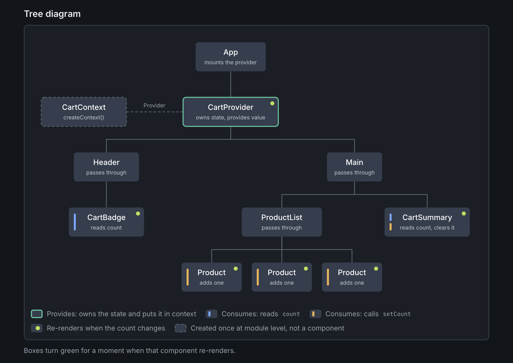
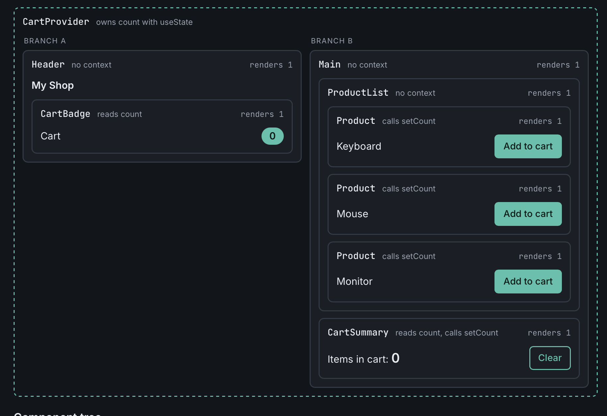

::: {.labs}
📘 **React JS Lab#RE08-2: Cart Shopping Context with useReducer**

This lab starts from [Lab#RE08-1: Cart Shopping Context](/reactjs/rjslab8-1.qmd) (**v0.1**), where `CartProvider` owned a single `count` with `useState`.

In **v0.2** we'll replace that number with a real cart: an array of items `{id, name, qty, price}`, managed with `useReducer`.

Here's an overview of what we'll cover:

1. **Why `useReducer`**: a count is easy with `useState`; an items array with add, decrement and clear is easier to follow in a reducer.
2. **A pure reducer**: one function, `cartReducer`, with three actions — `add`, `remove` and `clear` — in its own file.
3. **`dispatch`**: consumers no longer call `setCount`. They send an action. The provider is the only place that runs the reducer.
4. **The same tree**: `CartBadge`, `Product` and `CartSummary` still sit in two branches and still share state through `useCart`. What changes is *what* the context holds.


By the end of this lab, **Add to cart** will add a line (or bump its `qty`), the badge will show the total quantity, and `CartSummary` will list the items with a total price.

:::

</br>

{.lightbox width=100% fig-align="center"}

[Open the interactive Cart Context Demo](/images/reactjs/docs/cart-context-visuals.html){.external target='_blank'} (the demo still shows the **v0.1** `count`; use it as a reminder of the two branches). Previous lab: [Lab#RE08-1: Cart Shopping Context](/reactjs/rjslab8-1.qmd).

# References

- [Lab#RE08-1: Cart Shopping Context](/reactjs/rjslab8-1.qmd)
- [React JS: useReducer](/reactjs/reactjs-hook-reducer.qmd)
- [React JS: useContext](/reactjs/reactjs-hook-context.qmd)
- [React JS: render cycle](/reactjs/reactjs-what-immutability.qmd) (purity and immutability)
- [`useReducer`](https://react.dev/reference/react/useReducer){.external target='_blank'}
- [Extracting State Logic into a Reducer](https://react.dev/learn/extracting-state-logic-into-a-reducer){.external target='_blank'}
- GitHub repo: [AlbertProfe/cartShoppingContext](https://github.com/AlbertProfe/cartShoppingContext){.external target='_blank'}

# Starting point: v0.1

In v0.1 the provider looked like this:

``` {.jsx .code-overflow-wrap filename="src/context/CartContext.jsx (v0.1)"}
export function CartProvider({ children }) {
  const [count, setCount] = useState(0);
  return (
    <CartContext.Provider value={{ count, setCount }}>
      {children}
    </CartContext.Provider>
  );
}
```

That is enough when the cart is a single number. It gets messy once we want:

- a list of items, not just a count
- a **price** on each product, and a **total** in the summary
- **Add** (new line or `qty + 1`), **decrement** (and drop the line at 0), and **Clear**

All of those updates belong together. A reducer keeps them in one pure function, instead of several `setCount` / `setItems` calls spread across the tree.

The starting commit is [cartShoppingContext v0.1](https://github.com/AlbertProfe/cartShoppingContext/tree/471851d88da4cd173821dfe301237cc06d6ba956){.external target='_blank'}. This lab is [v0.2](https://github.com/AlbertProfe/cartShoppingContext/tree/ee6e008b4a05a6157edd73fd21e5b251dcfe7bb7){.external target='_blank'}.

# The reducer

The reducer lives in its own file, next to the provider. The state is `{ items }`. Each item is `{id, name, qty, price}`.

::: {.column-margin}
A reducer is a **pure function**: `(state, action) => newState`. It does not mutate `state`, and it does not touch the DOM. See [React JS: render cycle](/reactjs/reactjs-what-immutability.qmd).
:::

``` {.js .code-overflow-wrap filename="src/context/cartReducer.js"}
export const initialCart = { items: [] };

export function cartReducer(state, action) {
  switch (action.type) {
    case "add": {
      const { id, name, price } = action.payload;
      const existing = state.items.find((item) => item.id === id);
      if (existing) {
        return {
          items: state.items.map((item) =>
            item.id === id ? { ...item, qty: item.qty + 1 } : item
          ),
        };
      }
      return {
        items: [...state.items, { id, name, qty: 1, price }],
      };
    }
    case "remove": {
      const { id } = action.payload;
      return {
        items: state.items
          .map((item) =>
            item.id === id ? { ...item, qty: item.qty - 1 } : item
          )
          .filter((item) => item.qty > 0),
      };
    }
    case "clear":
      return { items: [] };
    default:
      return state;
  }
}
```

Three actions, kept small on purpose:

- **`add`**: if the product is already in the cart, bump `qty`; otherwise append a new line with `qty: 1`.
- **`remove`**: decrement `qty`. When it reaches 0, the line disappears.
- **`clear`**: back to an empty array.

Notice the copying: `map`, the spread `{ ...item, qty: item.qty + 1 }`, and `[...state.items, newItem]`. We never write `item.qty++` or `state.items.push(...)`.

Two small helpers derive the numbers the UI needs. They are also pure:

``` {.js .code-overflow-wrap filename="src/context/cartReducer.js"}
export function cartQty(items) {
  return items.reduce((sum, item) => sum + item.qty, 0);
}

export function cartTotal(items) {
  return items.reduce((sum, item) => sum + item.qty * item.price, 0);
}
```

# The provider: `useReducer` and `dispatch`

`CartProvider` still owns the state and still wraps both branches. It now calls `useReducer` and puts `{ items, dispatch }` on the context. There is no `setCount` any more.

``` {.jsx .code-overflow-wrap filename="src/context/CartContext.jsx"}
import { createContext, useReducer } from "react";
import { cartReducer, initialCart } from "./cartReducer";

export const CartContext = createContext();

export function CartProvider({ children }) {
  const [state, dispatch] = useReducer(cartReducer, initialCart);
  return (
    <CartContext.Provider value={{ items: state.items, dispatch }}>
      {children}
    </CartContext.Provider>
  );
}
```

::: {.column-margin}
`dispatch` is stable. Consumers send `{ type, payload }`. Only the reducer decides how the next `items` array looks.
:::

`useCart` does not change: it still returns whatever the provider put on the context.

``` {.js .code-overflow-wrap filename="src/hooks/useCart.js"}
import { useContext } from "react";
import { CartContext } from "../context/CartContext";

export const useCart = () => useContext(CartContext);
```

# Updated consumers

`Header`, `Main` and `App` stay as they were in v0.1. They still do not touch the context. The products now have a **price**. The shop still has only Keyboard and Mouse.

::: {.column-margin}
{.lightbox}

[Open the interactive Cart Context Demo](/images/reactjs/docs/cart-context-visuals.html){.external target='_blank'}
:::

``` {.jsx .code-overflow-wrap filename="src/ProductList/ProductList.jsx"}
import { Product } from "../Product/Product";

export function ProductList() {
  return (
    <ul>
      <Product id="keyboard" name="Keyboard" price={49} />
      <Product id="mouse" name="Mouse" price={25} />
    </ul>
  );
}
```

`Product` dispatches `add` with the product data. It does not read the cart.

``` {.jsx .code-overflow-wrap filename="src/Product/Product.jsx"}
import { useCart } from "../hooks/useCart";

export function Product({ id, name, price }) {
  const { dispatch } = useCart();
  return (
    <li>
      {name} — {price} €{" "}
      <button
        onClick={() =>
          dispatch({ type: "add", payload: { id, name, price } })
        }
      >
        Add to cart
      </button>
    </li>
  );
}
```

`CartBadge` shows the **total quantity** (Keyboard × 2 plus Mouse × 1 is 3), not the number of lines.

``` {.jsx .code-overflow-wrap filename="src/CartBadge/CartBadge.jsx"}
import { useCart } from "../hooks/useCart";
import { cartQty } from "../context/cartReducer";

export function CartBadge() {
  const { items } = useCart();
  return <span>🛒 {cartQty(items)}</span>;
}
```

`CartSummary` lists each line with its `qty` and line price, shows the **total**, and can decrement a line or **Clear** the cart.

``` {.jsx .code-overflow-wrap filename="src/CartSummary/CartSummary.jsx"}
import { useCart } from "../hooks/useCart";
import { cartTotal } from "../context/cartReducer";

export function CartSummary() {
  const { items, dispatch } = useCart();
  const total = cartTotal(items);

  return (
    <div>
      <h2>Cart</h2>
      {items.length === 0 ? (
        <p>The cart is empty.</p>
      ) : (
        <>
          <ul>
            {items.map((item) => (
              <li key={item.id}>
                {item.name} × {item.qty} — {item.qty * item.price} €{" "}
                <button
                  onClick={() =>
                    dispatch({ type: "remove", payload: { id: item.id } })
                  }
                >
                  −
                </button>
              </li>
            ))}
          </ul>
          <p>Total: {total} €</p>
          <button onClick={() => dispatch({ type: "clear" })}>Clear</button>
        </>
      )}
    </div>
  );
}
```

# What to notice

- **One `dispatch`.** `Product` adds, `CartSummary` decrements or clears, and nobody else needs a custom setter. The next state always comes from `cartReducer`.
- **The same consumers still re-render.** `CartBadge`, every `Product`, and `CartSummary` subscribe to the context. When `items` change, they all render again — even a `Product` that only uses `dispatch`. That is the same idea as in [Lab#RE08-1](/reactjs/rjslab8-1.qmd), and it is still why bigger apps split contexts.
- **The reducer is pure and immutable.** It returns a *new* `{ items }` object. It never mutates the previous state. That is what React expects when it decides whether to re-render: see [React JS: render cycle](/reactjs/reactjs-what-immutability.qmd).

# Next features

These later steps are **not** in this version of the repo:

- A **theme** toggle (dark / light) read by many components. That would be its own `ThemeContext`, not more fields on the cart.
- A **logged-in user** shown in the navbar and used by a profile page. Again, a separate `UserContext`.

# Code

::: {.column-page-right}

| Code Version | Commit | Folder-Tree | Output |
| -- | -- | -- | -- |
| [GitHub code v0.1](https://github.com/AlbertProfe/cartShoppingContext/tree/471851d88da4cd173821dfe301237cc06d6ba956){.external target='_blank'}  | cart context with `useState` and a `count` (Lab#RE08-1) | [repo at v0.1](https://github.com/AlbertProfe/cartShoppingContext/tree/471851d88da4cd173821dfe301237cc06d6ba956){.external target='_blank'} | [tree diagram](/images/reactjs/cart-context-tree-diagram.png){.external target='_blank'}, [playground render](/images/reactjs/cart-context-branches-diagram.png){.external target='_blank'}, [interactive demo](/images/reactjs/docs/cart-context-visuals.html){.external target='_blank'} |
| [GitHub code v0.2](https://github.com/AlbertProfe/cartShoppingContext/tree/ee6e008b4a05a6157edd73fd21e5b251dcfe7bb7){.external target='_blank'}  | items array `{id, name, qty, price}` with `useReducer`: `add`, `remove`, `clear` | [repo at v0.2](https://github.com/AlbertProfe/cartShoppingContext/tree/ee6e008b4a05a6157edd73fd21e5b251dcfe7bb7){.external target='_blank'} |  |

:::
